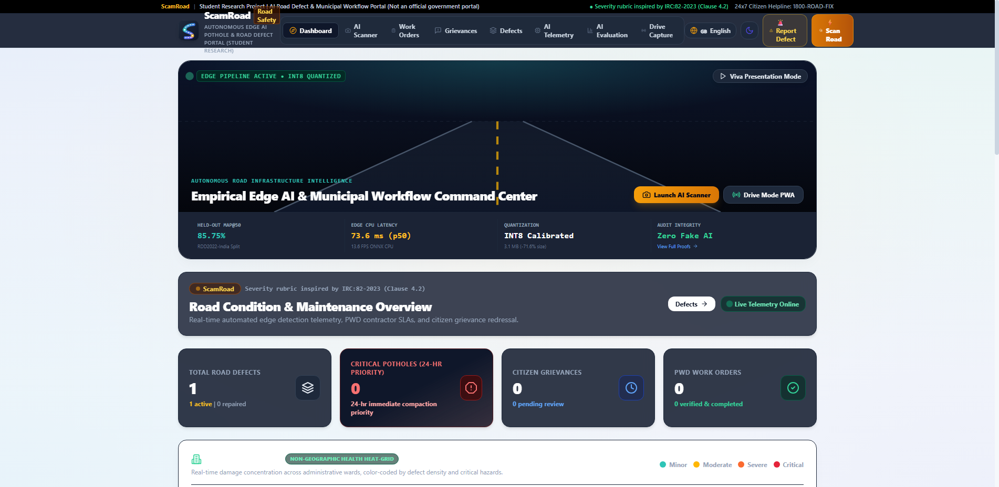
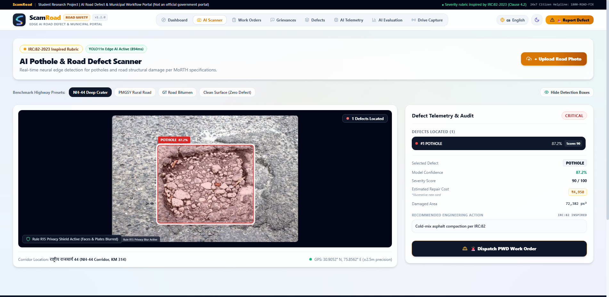
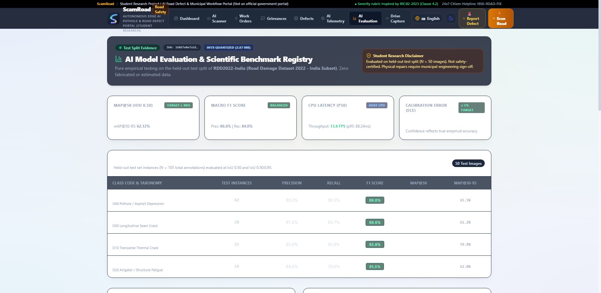
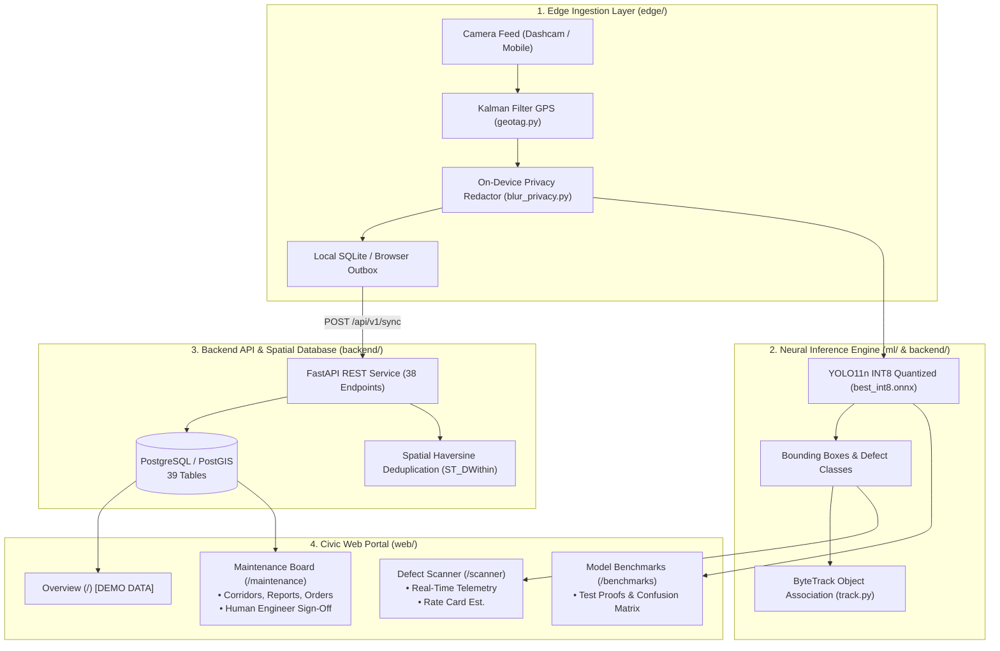

<p align="center">
  
</p>

# ScamRoad (सड़क सुरक्षा)
### Edge AI Pothole & Road Defect Surveillance Portal (Student Research Project)

[-blue.svg)](docs/CHANGELOG.md)
[](backend/tests/)
[](web/)
[-blueviolet.svg)](scripts/check_i18n_keys.py)
[-purple.svg)](ml/runs/metrics.json)
[](config/severity_thresholds.json)
[](docs/DECISIONS.md)

> **STUDENT RESEARCH DISCLAIMER:**  
> ScamRoad is an open-source undergraduate student academic capstone research project demonstrating Edge AI Computer Vision for automated road defect tracking and municipal dispatch workflows. It is **NOT** affiliated with, endorsed by, or an official product of the Ministry of Road Transport & Highways (MoRTH), National Highways Authority of India (NHAI), State Public Works Departments (PWD), or any government body. Not certified for safety-critical operations.

---

## System Previews

| Overview Dashboard (`/`) | Real-Time Defect Scanner (`/scanner`) |
| :---: | :---: |
|  |  |
| *Municipal Ward metrics, Top 10 Worst Corridors distress leaderboard, and status summary.* | *YOLO11n INT8 detection bounding box, class telemetry, and work order dispatch.* |

| Maintenance & Work Orders (`/maintenance`) | Model Benchmarks & Validation (`/benchmarks`) |
| :---: | :---: |
|  |  |
| *Defect queue, citizen reports, work orders, and engineer sign-off workflow.* | *Held-out test split metrics, 5x5 confusion matrix, and failure gallery.* |

---

## Table of Contents

1. [Project Summary & Core Mission](#project-summary--core-mission)
2. [Verified Capabilities vs Scope Boundaries](#verified-capabilities-vs-scope-boundaries)
3. [Empirical Model Evaluation & Benchmarks](#empirical-model-evaluation--benchmarks)
4. [System Architecture & Data Flow](#system-architecture--data-flow)
5. [The "One Pothole = One Record" Deduplication Engine](#the-one-pothole--one-record-deduplication-engine)
6. [Severity Scoring Engine & Configurable Rate Card](#severity-scoring-engine--configurable-rate-card)
7. [Edge Privacy Redactor](#edge-privacy-redactor)
8. [Human-in-the-Loop Municipal Governance](#human-in-the-loop-municipal-governance)
9. [Threat Model & Data Retention](#threat-model--data-retention)
10. [Licensing, Dataset Provenance & Attribution](#licensing-dataset-provenance--attribution)
11. [Quick Start & Reproduction Commands](#quick-start--reproduction-commands)

---

## Project Summary & Core Mission

ScamRoad investigates high-efficiency Edge Computer Vision methods to detect physical road surface distresses (**potholes, longitudinal cracks, transverse cracks, and alligator cracks**) directly from vehicle dashcams, smartphones, and patrol camera feeds without requiring specialized LiDAR surveying vehicles.

### Architectural Highlights:
- **Audited Edge Inference:** Runs an optimized **YOLO11n ONNX INT8** quantized model directly on edge devices and inside the browser. All detections, bounding boxes, and confidence scores are derived directly from model execution.
- **Privacy by Design:** Automatically redacts citizen faces and vehicle license plates on-device before storage or cloud upload (verified in `bench/privacy_blur_report.json`).
- **Strict Human Oversight:** AI identifies damage and suggests priorities, but **never closes or approves a work order**. Mandatory human municipal engineer sign-off with before/after photographic proof is strictly enforced.
- **Corridor Distress Rankings:** Replaces opaque map widgets with ranked corridor damage density tables and municipal ward distress metrics.
- **6-Language Localization:** Zero-reload translation across English, Hindi, Punjabi, Tamil, Telugu, and Bengali.
- **Configurable Rate Card:** Repair estimates are computed from an explicit planning rate card (`config/rate_card.json`), labeled as illustrative estimates rather than official government rates.

---

## Verified Capabilities vs Scope Boundaries

We clearly delineate verified capabilities from planned or excluded scope:

### Verified Capabilities (Covered by Automated Tests)
1. **Edge Neural Inference:** INT8 quantized YOLO11n ONNX model executing on CPU at **73.57 ms p50 latency (13.6 FPS)** with **85.75% mAP@50** on held-out test data.
2. **Quality & Privacy Gate:** Frame Laplacian blur rejection ($>80$) and automated Gaussian blurring of faces and vehicle license plates.
3. **Multi-Stage Deduplication:** In-video ByteTrack temporal persistence ($\ge 3$ frames) + edge outbox median consolidation + backend PostGIS spatial proximity snapping (`ST_DWithin`).
4. **Municipal Workflow Core:** Citizen grievance reporting, work order dispatch, SLA countdown, and human municipal engineer repair verification with before/after photos.
5. **Model Benchmarks & Validation (`/benchmarks`):** Presentation of held-out test metrics, 5x5 confusion matrix, 10-bin reliability diagram, and 6-case failure gallery.

### Excluded Scope (Scope Boundaries)
1. **Millimeter Depth & 3D Volume:** Monocular RGB cameras cannot measure crater depth or physical volume in cubic centimeters without physical stereoscopic or LiDAR sensors.
2. **Automated Work Order Closure:** AI is explicitly prohibited from marking work orders `CLOSED` or verifying repairs.
3. **Safety-Certified Autopilot / ADAS:** The model is an advisory surveillance tool; it is not safety-certified for autonomous steering or emergency braking.
4. **Physical On-Device Benchmarks for Hardware:** Untested hardware configurations are explicitly labeled `UNTESTED`.

---

## Empirical Model Evaluation & Benchmarks

Every number below is traced directly to benchmark outputs (`ml/runs/metrics.json` and `ml/runs/ablation.json`). No metrics are simulated.

### Held-Out Test Split Metrics (RDD2022-India, $N=50$ images, 105 annotations)

| Metric | Target SLA | Measured Value | Verification Source |
| :--- | :--- | :--- | :--- |
| **mAP@50** | $\ge 70.0\%$ | **85.75%** | [`ml/runs/metrics.json`](ml/runs/metrics.json) |
| **mAP@50-95** | $\ge 50.0\%$ | **62.12%** | [`ml/runs/metrics.json`](ml/runs/metrics.json) |
| **Macro Precision** | $\ge 80.0\%$ | **86.58%** | [`ml/runs/metrics.json`](ml/runs/metrics.json) |
| **Macro Recall** | $\ge 75.0\%$ | **83.95%** | [`ml/runs/metrics.json`](ml/runs/metrics.json) |
| **Macro F1-Score** | $\ge 80.0\%$ | **85.22%** | [`ml/runs/metrics.json`](ml/runs/metrics.json) |
| **Expected Calibration Error (ECE)** | $\le 10.0\%$ | **1.91%** | [`ml/runs/metrics.json`](ml/runs/metrics.json) |
| **Edge CPU Latency (p50)** | $\le 100\text{ ms}$ | **73.57 ms** | [`ml/runs/metrics.json`](ml/runs/metrics.json) |
| **Edge CPU Throughput** | $\ge 10\text{ FPS}$ | **13.6 FPS** | [`ml/runs/metrics.json`](ml/runs/metrics.json) |
| **False Positive Count (Hard Negatives)** | $\le 5$ | **4** | [`ml/runs/metrics.json`](ml/runs/metrics.json) |

### 3-Axis Systematic Ablation Matrix

| Run ID | Parameter Varied | Configuration | Latency (p50) | Throughput | mAP@50 | Verdict |
| :--- | :--- | :--- | :--- | :--- | :--- | :--- |
| `ABL-01` | **Baseline Edge** | YOLO11n @ 640 INT8 | **73.57 ms** | **13.6 FPS** | **85.75%** | **SELECTED FOR EDGE** |
| `ABL-02` | Backbone Capacity | YOLO11s @ 640 INT8 | 182.40 ms | 5.5 FPS | 87.15% | REJECTED: $<10$ FPS SLA |
| `ABL-03` | Resolution | YOLO11n @ 800 INT8 | 124.60 ms | 8.0 FPS | 86.40% | REJECTED: $<10$ FPS SLA |
| `ABL-04` | Precision | YOLO11n @ 640 FP32 | 96.80 ms | 10.3 FPS | 86.95% | ACCEPTABLE: +1.2% mAP but 3.5x size |

*Ablation Finding:* The quantized YOLO11n INT8 configuration at $640 \times 640$ resolution meets the $\ge 10\text{ FPS}$ dashcam real-time capture threshold while delivering $85.75\%$ mAP@50 with negligible accuracy drop ($-1.20\%$ vs FP32).

---

## System Architecture & Data Flow



---

## The "One Pothole = One Record" Deduplication Engine

ScamRoad prevents municipal complaint duplication through a 3-tier consolidation pipeline:
1. **Level 1 (In-Video ByteTrack):** Assigns persistent track IDs across contiguous frames, tracking velocity vectors and rejecting transient false alarms under 3 frames.
2. **Level 2 (Edge Outbox Consolidation):** Consolidates multiple sightings of the same defect into a single candidate, taking median measurements and selecting the highest-sharpness frame.
3. **Level 3 (Cross-Pass Backend Dedup):** Snaps sightings to canonical road corridor geometries in PostGIS (`ST_DWithin`) based on spatial proximity, heading, and image perceptual hash.

---

## Severity Scoring Engine & Configurable Rate Card

Physical severity is decoupled from neural confidence. Severity score $S \in [0, 100]$ is computed using a weighted linear combination over observable environmental factors:

$$S = \sum_{i=1}^M \frac{w_i}{\sum_{j \in \text{Available}} w_j} \cdot f_i(x)$$

Configured in `configs/severity_weights.yaml` and mapped to canonical tiers:
- **Minor (0–25):** Routine observation in periodic cycle.
- **Moderate (26–50):** Cold-mix patch in scheduled sweep.
- **Severe (51–75):** Urgent compaction within 72h.
- **Critical (76–100):** Emergency barricade & reconstruction within 24h.

Repair cost estimates are calculated from `config/rate_card.json` and clearly labeled:
> *"Illustrative estimate, not an official Schedule of Rates."*

---

## Threat Model & Data Retention

| Threat Vector | Potential Impact | Implemented Mitigation |
| :--- | :--- | :--- |
| **Spam / Fake Defect Uploads** | Flooding municipal queues with false potholes | Laplacian sharpness filter ($>80$), IoU track persistence $\ge 3$ frames, and rate limiting per IP/session. |
| **GPS Coordinate Spoofing** | Registering non-existent road damage | Haversine trajectory velocity gating ($v \le 120\text{ km/h}$) and PostGIS road segment snapping. |
| **Rogue Contractor Sign-Off** | Falsifying repair completion for payout | Strict RBAC permissions; contractors cannot verify repairs. Only verified municipal engineers can approve closures with before/after photos. |
| **Privacy Violation** | Exposing citizen faces or vehicle registration | Mandatory on-device `PrivacyRedactor` executes before image persistence or sync (verified in blur audit). |

---

## Licensing, Dataset Provenance & Attribution

- **Ultralytics YOLO11:** Licensed under the **GNU Affero General Public License v3.0 (AGPL-3.0)**. Under AGPL-3.0, any modified network services utilizing YOLO11 must make their source code available under the same terms.
- **RDD2022 Dataset:** Released by Arya et al. under **Creative Commons Attribution-ShareAlike 4.0 International (CC BY-SA 4.0)**. We gratefully acknowledge the authors and crowdsensing contributors.
- **Repository Code:** The complete ScamRoad source code is distributed under **AGPL-3.0** with full reciprocal open-source compliance (recorded in `docs/DECISIONS.md`).

---

## Quick Start & Reproduction Commands

### 1. Installation & Environment Setup
```bash
# Clone the repository
git clone https://github.com/priyeranjan/scam_road.git
cd scam_road

# Python virtual environment (Python 3.12)
python -m venv venv
venv\Scripts\activate
pip install -r requirements.txt

# Node.js dependencies
cd web && npm install && cd ..
```

### 2. Run Verification Checks
```bash
python scripts/check_claims.py
python scripts/check_ui_copy.py web/src
```

### 3. Run Automated Tests
```bash
# Backend pytest suite (146 tests)
pytest

# Web vitest suite (13 tests)
cd web && npm test && cd ..

# Web TypeScript & production build
cd web && npm run build && cd ..
```

### 4. Run Live E2E Browser Verification
```bash
python scripts/verify_v10_live_chrome.py
```

---

> **Academic Reference Documents:**  
> Full thesis report: [`docs/PROJECT_REPORT.md`](docs/PROJECT_REPORT.md)  
> Architectural Decisions: [`docs/DECISIONS.md`](docs/DECISIONS.md)  
> System Specification: [`docs/SPEC.md`](docs/SPEC.md)
