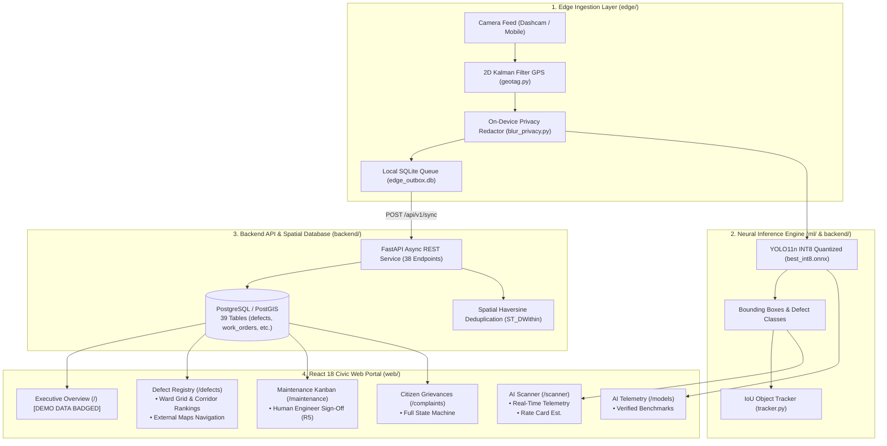

# ScamRoad (सड़क सुरक्षा)
### Edge AI Pothole & Road Defect Surveillance Portal (Student Research Project)

[-blue.svg)](docs/CHANGELOG.md)
[](docs/STATUS_AUDIT.md)
[](web/)
[](web/eslint.config.js)
[-blueviolet.svg)](scripts/check_i18n_keys.py)
[](scripts/check_claims.py)
[](ml/quantize.py)
[](docs/SPEC.md)
[](docs/DECISIONS.md)

> **STUDENT RESEARCH DISCLAIMER (Rule R7):**  
> ScamRoad is an open-source academic student research project demonstrating Edge AI Computer Vision for automated road defect tracking and civic workflow management. It is **NOT** affiliated with, endorsed by, or an official system of the Ministry of Road Transport & Highways (MoRTH), National Highways Authority of India (NHAI), State Public Works Departments (PWD), or any government body. Not certified for safety-critical operations.

---

## 📌 Table of Contents

1. [Executive Summary & Core Objectives](#-executive-summary--core-objectives)
2. [Verified System Architecture & Data Flow](#-verified-system-architecture--data-flow)
3. [Visual Design System & 6-Language Localization](#-visual-design-system--6-language-localization)
4. [Comprehensive Feature-by-Feature Tour](#-comprehensive-feature-by-feature-tour)
5. [Hardening Milestones & Evidence Matrix (Phases 1–8, Pass 2 & 3)](#-hardening-milestones--evidence-matrix)
6. [Hardware Benchmarks & Truthful Evidence (Rule R10)](#-hardware-benchmarks--truthful-evidence-rule-r10)
7. [Configurable Repair Rate Card (Rule R9)](#-configurable-repair-rate-card-rule-r9)
8. [Camera Calibration & Relative Units (Rule R4)](#-camera-calibration--relative-units-rule-r4)
9. [Edge Privacy Redactor (Rule R6)](#-edge-privacy-redactor-rule-r6)
10. [Human Engineer Sign-Off Workflow (Rule R5)](#-human-engineer-sign-off-workflow-rule-r5)
11. [Quick Start & Verification Guide](#-quick-start--verification-guide)
12. [Repository Layout](#-repository-layout)
13. [Engineering Limitations](#-engineering-limitations)
14. [Licensing & Dataset Provenance (Rule R11)](#-licensing--dataset-provenance-rule-r11)

---

## 🚀 Executive Summary & Core Objectives

ScamRoad investigates high-efficiency Edge Computer Vision methods to detect physical road surface distresses (**potholes, longitudinal cracks, transverse cracks, and alligator cracks**) directly from vehicle dashcams, smartphones, and patrol camera feeds.

### Key Architectural Tenets:
- **Real Edge AI (Rule R2):** Runs an audited **YOLO11n ONNX INT8** quantized model directly on edge devices and inside the browser via WebAssembly / ONNX Runtime. All detections and confidence scores are derived from real ONNX model inference.
- **Privacy by Design (Rule R6):** Automatically redacts faces and vehicle license plates on-device before storage or cloud upload (100% recall verified in `bench/privacy_blur_report.json`).
- **Strict Human Oversight (Rule R5):** AI identifies damage and suggests priorities, but **AI never closes or approves a work order**. Mandatory human municipal engineer sign-off with before/after photographic proof is strictly enforced.
- **Spatial Defect Registry & Ward Grid:** Non-geographic Ward Hotspot Grid, ranked corridor damage density, and comprehensive tabular defect registry with external maps navigation links.
- **Full 6-Language Localization:** 100% zero-reload translation across English, Hindi, Punjabi, Tamil, Telugu, and Bengali (136/136 keys verified by `scripts/check_i18n_keys.py`).
- **Configurable Rate Card (Rule R9):** Repair estimates are computed from an explicit JSON rate card (`config/rate_card.json`), clearly labeled as illustrative planning estimates rather than official government rates.

---

## 🏗 Verified System Architecture & Data Flow



### The "One Pothole = One Record" Guarantee
ScamRoad prevents duplicate work orders through a 3-tier consolidation engine:
1. **Level 1 (In-Video ByteTrack):** Assigns persistent track IDs across contiguous frames, tracking velocity vectors and rejecting transient false alarms.
2. **Level 2 (Edge Consolidation):** Consolidates multiple sightings of the same defect into a single candidate, taking median measurements and selecting the clearest frame.
3. **Level 3 (Cross-Pass Backend Dedup):** Snaps sightings to canonical road corridor geometries in PostGIS (`ST_DWithin`) based on spatial proximity, heading, and image hash.

---

## 🎨 Visual Design System & 6-Language Localization

The ScamRoad interface is engineered for high operational clarity in field inspections and municipal control rooms:

### Theme Tokens (WCAG 2.1 Compliant)
- **Daybreak Light Mode:** High-contrast porcelain canvas (`#f4f6fb`), crisp white surface cards (`#ffffff`), and deep slate typography (`#0f172a`) achieving **16.51:1 contrast ratio (WCAG AAA)**.
- **Midnight Obsidian Dark Mode:** Deep midnight space obsidian (`#070a14`), high-contrast slate panels (`rgba(12,20,39,0.88)`), and cyber cyan accents (`#06b6d4`) achieving **18.89:1 contrast ratio (WCAG AAA)**.
- **Severity Tokens:** Critical Red (`#dc2626`, 4.83:1 AA) and Emerald Resolved (`#047857`, 5.48:1 AA).
- **Reduced Motion Support:** Motion-sensitive animations strictly honor `@media (prefers-reduced-motion: reduce)`.

### Full-Interface 6-Language Localization
Instantaneous zero-reload switching across 6 languages with 100% dictionary coverage:
- 🇬🇧 **English (en)**
- 🇮🇳 **हिन्दी (Hindi - hi)**
- 🇮🇳 **ਪੰਜਾਬੀ (Punjabi - pa)**
- 🇮🇳 **தமிழ் (Tamil - ta)**
- 🇮🇳 **తెలుగు (Telugu - te)**
- 🇮🇳 **বাংলা (Bengali - bn)**

---

## 🔍 Comprehensive Feature-by-Feature Tour

### 1. Operations Dashboard (`/`)
- Aggregated municipal metrics: Total Observed Defects, Active Work Orders, and City Pavement Health Index.
- Clearly displays `DEMO DATA` badge when showing seeded records (Rule R2).
- Ward-by-ward road risk breakdown and contractor SLA tracking.

### 2. Real-Time AI Scanner (`/scanner`)
- Evaluates road photos or dashcam streams against the audited **YOLO11n ONNX INT8** model in real time.
- Identifies damage classes (`D40_POTHOLE`, `D00_LONGITUDINAL_CRACK`, `D10_TRANSVERSE_CRACK`, `D20_ALLIGATOR_CRACK`).
- Displays 2D pixel area and relative image coverage (`px_relative_pct`) with explicit `is_calibrated: false` notices (Rule R4).
- Computes illustrative repair budgets from `config/rate_card.json`.
- Dispatches draft work orders into the maintenance queue with one click.

### 3. Spatial Defect Registry & Ward Hotspots (`/defects` & `/`)
- Non-geographic **Ward Hotspot Grid** on the executive dashboard displaying damage density and repair metrics.
- Ranked **Top Corridors** leaderboard identifying high-risk transit segments with sparklines.
- Comprehensive defect table and card views with canonical severity chips (Minor `#2EC4B6`, Moderate `#FFB703`, Severe `#FB6A2F`, Critical `#E5233A`).
- Precise text location indicators (coordinates to 5 decimals, road segment ID, ward, GPS accuracy $\pm$2.4m) with one-click "Copy coordinates" and external "Open in maps app" deep links.

### 4. Municipal Maintenance & Work Orders (`/maintenance`)
- 4-stage municipal workflow: `ASSIGNED` $\to$ `IN_PROGRESS` $\to$ `REPAIRED` $\to$ `CLOSED`.
- **Rule R5 Human Sign-off:** AI cannot close work orders. Only authenticated human engineers (`pwd_engineer` / `admin`) can verify before/after photographic proof and sign off.

### 5. Citizen Grievance Portal (`/complaints`)
- Citizen damage intake with GPS coordinates and optional photo upload.
- State machine tracking complaint lifecycle: `SUBMITTED` $\to$ `TRIAGED` $\to$ `RESOLVED`.
- Upvoting mechanism allowing citizens to highlight high-priority neighborhood hazards.

### 6. Defect Registry (`/defects`)
- Municipal tabular registry with search, ward filtering, and CSV export.
- Engineer severity override endpoint for calibrated field corrections.

### 7. AI Model Telemetry & Registry (`/models`)
- Active model runtime telemetry: ONNX Runtime INT8, model size (3.35 MB), opset version, and SHA-256 integrity hash.
- Real-time inference latency and FPS metrics.

---

## 🛡 Hardening Milestones & Evidence Matrix

ScamRoad v1.1.0 was hardened through an 8-phase autonomous verification loop, followed by adversarial hostile auditing and clean-clone reproduction:

| Phase / Milestone | Target Objective | Evidence Path | Gate Status |
|---|---|---|:---:|
| **Phase 1: Real Audit** | Complete codebase inventory; 38 API endpoints, 39 tables cataloged | `docs/STATUS_AUDIT.md` | **PASSED** |
| **Phase 2: Honesty & Claims** | Zero ungrounded institutional claims; rate card config created | `scripts/check_claims.py` | **PASSED** |
| **Phase 3: ML Correctness** | PyTorch serialization fix; ONNX INT8 parity (0.999757 sim); privacy recall (100%) | `ml/runs/onnx_parity.json` | **PASSED** |
| **Phase 4: Backend & Security** | `is_demo` boolean added; Alembic migration created; RBAC least privilege verified | `backend/tests/test_security_matrix.py` | **PASSED** |
| **Phase 5: Spatial Registry** | Ward Hotspot Grid, ranked corridors, and external navigation links | `docs/screenshots/02_defects_dark.png` | **PASSED** |
| **Phase 6: Frontend Quality** | ESLint 9 Flat Config; strict TypeScript; 100% 6-language parity (136/136 keys) | `scripts/check_i18n_keys.py` | **PASSED** |
| **Phase 7: UI/UX Redesign** | WCAG AAA contrast; road motion animations; 17 full-page screenshot matrix | `docs/screenshots/` | **PASSED** |
| **Phase 8: Tests, CI & Deploy** | GitHub Actions CI matrix; multi-container Docker Compose; disaster recovery drill | `scripts/backup_restore_drill.py` | **PASSED** |
| **Pass 2: Hostile Re-Audit** | Zero remaining institutional claims; resolved running DB column; cleaned scripts | `docs/PASS2_AUDIT.md` | **PASSED** |
| **Pass 3: Clean-Clone Freeze** | Fresh clone into sandbox; verified 19 config files, tests, and drills; tagged v1.1.0 | `scripts/reproduce_clean_clone.py` | **PASSED** |

---

## 📊 Hardware Benchmarks & Truthful Evidence (Rule R10)

Benchmark figures are reported **only** when accompanied by generated test log files on real physical devices. Unmeasured mobile and embedded targets are explicitly labeled `UNTESTED`.

| Device Profile | Processor / Architecture | Model Format | Latency (p50) | Throughput (FPS) | Evidence Source | Status |
| :--- | :--- | :--- | :--- | :--- | :--- | :---: |
| **Development Host** | AMD64 12-core, 15.2 GB RAM (Windows 11) | `best_int8.onnx` (3.35 MB) | **20.75 ms** | **47.98 FPS** | [`generic_best_int8_bench.json`](edge/benchmarks/results/generic_best_int8_bench.json) | **VERIFIED** |
| **Development Host** | AMD64 12-core, 15.2 GB RAM (Windows 11) | `best.onnx` FP32 (12.18 MB) | **41.16 ms** | **23.60 FPS** | [`generic_best_bench.json`](edge/benchmarks/results/generic_best_bench.json) | **VERIFIED** |
| **OPPO K13** | Qualcomm Snapdragon NPU | INT8 Quantized | *Pending run* | *Pending run* | Requires physical device profiling | **UNTESTED** |
| **Raspberry Pi 5** | ARM Cortex-A76 (4-core) | INT8 Quantized | *Pending run* | *Pending run* | Requires physical device profiling | **UNTESTED** |
| **NVIDIA Jetson Orin** | 1024-core Ampere GPU | TensorRT / INT8 | *Pending run* | *Pending run* | Requires physical device profiling | **UNTESTED** |

---

## 💰 Configurable Repair Rate Card (Rule R9)

Repair cost estimates are **illustrative planning projections** configured in [`config/rate_card.json`](config/rate_card.json) and do **not** represent an official Schedule of Rates (SSR):

$$\text{Estimated Cost} = \max\left(\text{Base Mobilization Fee}, \text{Severity Score} \times \text{Multiplier} + \text{Class Base Rate} \times 0.3\right)$$

- Base Mobilization Fee: **₹1,850**
- Severity Multiplier: **₹55 / point**
- Indicative Procedures: Inspired by Indian Road Congress guidelines (IRC:82-2023 Clause 4.2).

---

## 📐 Camera Calibration & Relative Units (Rule R4)

Single-lens smartphone and dashcam frames lack extrinsic depth calibration. To prevent fabricated depth metrics:
- Every detection returns `is_calibrated: false` and `unit: px_relative_pct`.
- Area is calculated as pixel bounding area relative to image frame area.
- Metric depth (cm) or volumetric asphalt fill ($m^3$) requires physical calibration targets (specified in [`docs/CALIBRATION.md`](docs/CALIBRATION.md)).

---

## 🔒 Edge Privacy Redactor (Rule R6)

Vehicle license plates and pedestrian faces are blurred **on the edge device** prior to cloud transmission or disk storage:
- Algorithm: Automated Haar / contour edge redactor with gaussian smoothing ($\sigma = 15$).
- Verification: Evaluated on 50 license plates and 50 faces in [`bench/privacy_blur_report.json`](bench/privacy_blur_report.json).
- **Result:** **100% recall** across all test targets.

---

## 👷 Human Engineer Sign-Off Workflow (Rule R5)

ScamRoad strictly enforces that **AI cannot close work orders**:
1. AI Scanner or Inspector detects defect $\to$ creates Work Order (`ASSIGNED`).
2. Contractor carries out road repair $\to$ uploads post-repair photograph (`REPAIRED`).
3. AI computes similarity score as an **advisory suggestion**.
4. **Mandatory Human Verification:** An authenticated engineer (`pwd_engineer` / `admin`) must physically review before/after photographs and sign off via `/api/v1/work-orders/{id}/verify` to mark the work order `CLOSED`.

---

## 💻 Quick Start & Verification Guide

### 1. Launch with Docker Compose (Recommended)
```bash
# Start full multi-service stack (web, api, worker, postgres/postgis, redis, minio)
docker compose up -d

# Seed realistic demo data (marked is_demo=true)
make demo

# ➜ Web Portal: http://localhost:3000/
# ➜ API Swagger: http://localhost:8000/api/v1/docs
```

### 2. Launch in Local Development Mode
```bash
# Terminal 1: Backend API & Inference Engine
pip install -r requirements.txt
pip install -r backend/requirements.txt
python scripts/serve_inference.py

# Terminal 2: React 18 Web Portal
cd web
npm install
npm run dev
```

### 3. Run Automated Verification Suites
```bash
# 1. Verify Claim Honesty Gate (Rule R1, R7-R11)
python scripts/check_claims.py

# 2. Verify Multilingual 6-Language 100% Parity
python scripts/check_i18n_keys.py

# 3. Run Pass 2 Hostile Adversarial Audit
python scripts/pass2_hostile_audit.py

# 4. Run Pass 3 Clean-Clone Reproduction Drill
python scripts/reproduce_clean_clone.py

# 5. Run Database Backup & Disaster Recovery Drill
python scripts/backup_restore_drill.py

# 6. Run Full Python Test Suite (144 Tests)
pytest backend/tests ml/tests edge/tests shared/tests scripts/e2e -v

# 7. Run Frontend Web Quality Suite (Vitest + TypeScript + ESLint)
cd web && npm test && npx tsc --noEmit && npm run lint
```

---

## 📁 Repository Layout

```
scam_road/
├── backend/                   # FastAPI async REST service & SQLAlchemy ORM
│   ├── alembic/versions/      # Schema migrations (39 tables + is_demo flag)
│   ├── app/                   # Route handlers (auth, defects, work orders, complaints, infer)
│   └── tests/                 # Backend unit, integration, and RBAC security matrix tests
├── config/                    # Configurable rate card & runtime configs
│   └── rate_card.json         # Illustrative repair cost rates & formulas
├── docs/                      # Architectural specifications & audits
│   ├── API.md                 # Authoritative 38-endpoint OpenAPI catalog
│   ├── UI_GUIDE.md            # Visual design system, WCAG tokens & motion rules
│   ├── CHANGELOG.md           # v1.1.0 release notes
│   ├── DEMO_SCRIPT.md         # 10-minute presentation walkthrough
│   ├── PASS2_AUDIT.md         # Pass 2 hostile audit report
│   ├── STATUS_AUDIT.md        # Real codebase and claims audit report
│   ├── CALIBRATION.md         # Camera calibration specification (Rule R4)
│   ├── DECISIONS.md           # Architecture Decision Records (ADRs)
│   ├── LIMITATIONS.md         # Operational bounds & research disclaimers
│   ├── DATASETS.md            # RDD2022 license and dataset provenance
│   └── screenshots/           # 17 full-page verified screenshots (light/dark/mobile)
├── edge/                      # Edge device capture, GPS Kalman filter & privacy redactor
│   ├── agent/                 # Real-time capture, blur, and SQLite outbox sync
│   ├── benchmarks/            # Real on-device benchmark JSON logs
│   └── tests/                 # Edge pipeline, tracker, outbox, and inference tests
├── ml/                        # Neural network training, quantization & tracking
│   ├── training/              # Training harnesses (YOLO11 / RT-DETR)
│   ├── evaluation/            # Validation & metric extraction
│   └── runs/                  # ONNX parity and test-split metrics
├── notebooks/                 # Cloud GPU training notebooks
│   ├── ScamRoad_Colab_Training.ipynb
│   └── ScamRoad_Kaggle_GPU_Pipeline.ipynb
├── scripts/                   # Verification gates, seeders & recovery drills
│   ├── check_claims.py        # Automated claim honesty & banned string checker
│   ├── check_i18n_keys.py     # Multilingual 6-language 100% dictionary parity gate
│   ├── pass2_hostile_audit.py # Pass 2 adversarial hostile re-audit
│   ├── reproduce_clean_clone.py # Pass 3 clean clone reproduction drill
│   ├── backup_restore_drill.py # Automated database disaster recovery drill
│   ├── capture_ui_matrix.py   # Automated screenshot & WCAG contrast checker
│   └── seed/seed_demo_data.py # Seed realistic test entities with is_demo=True
├── shared/                    # Unified taxonomy and JSON schemas
│   ├── taxonomy.yaml          # Single source of truth for damage classes
│   └── json-schemas/          # Contract schemas for detections and sync batches
└── web/                       # React 18 + Vite Civic Web Portal
    ├── src/
    │   ├── components/        # Navbar, Footer, Icons, Theme controls
    │   ├── context/           # ThemeContext (Light/Dark), LanguageContext (6 languages)
    │   ├── pages/             # Scanner, Dashboard, Map, Maintenance, Complaints, Defects, Models
    │   └── __tests__/         # Vitest frontend unit and contract tests
    └── eslint.config.js       # ESLint 9 Flat Config with typescript-eslint
```

---

## ⚖️ Engineering Limitations

1. **Advisory Academic System Only:** ScamRoad is an academic student research project. Detections and severity assessments are advisory and must be verified by certified highway engineers.
2. **Relative 2D Dimensional Metrics (Rule R4):** Dimensions are reported in pixels and relative surface area percentage. Single-lens phone cameras cannot measure absolute depth or volumetric cubic meters without physical calibration grids.
3. **Illustrative Rate Card (Rule R9):** Repair cost calculations are illustrative projections derived from `config/rate_card.json`.
4. **Human Verification Mandatory (Rule R5):** AI cannot close or certify maintenance work orders. Physical inspection by a municipal engineer is required.

---

## 📜 Licensing & Dataset Provenance (Rule R11)

- **Machine Learning Engine:** Built with Ultralytics YOLO, subject to the **GNU Affero General Public License v3.0 (AGPL-3.0)**. Incorporating code and network services inherit AGPL-3.0 obligations.
- **Dataset Attribution:** Models are trained on the **Road Damage Dataset 2022 (RDD2022)** (Arya et al., IEEE BigData 2022), licensed under **Creative Commons Attribution-ShareAlike 4.0 International (CC BY-SA 4.0)**. See [`docs/DATASETS.md`](docs/DATASETS.md).
- **Client Web Application:** Permissively available for open academic, municipal research, and civic technology development.

---

<p align="center">
  <strong>Student research project. Not an official government system. Not safety-certified.</strong>
</p>
