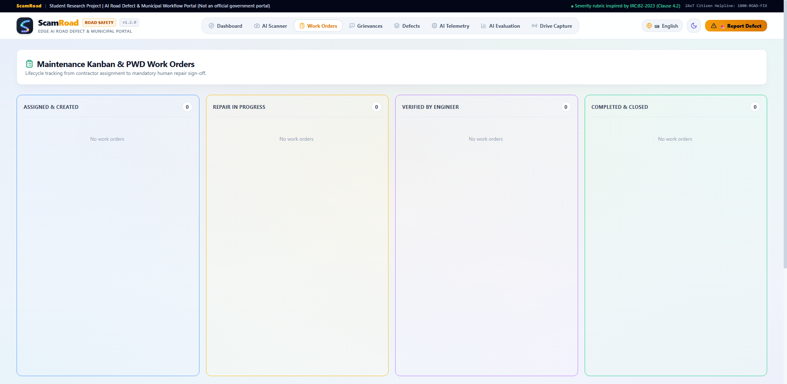
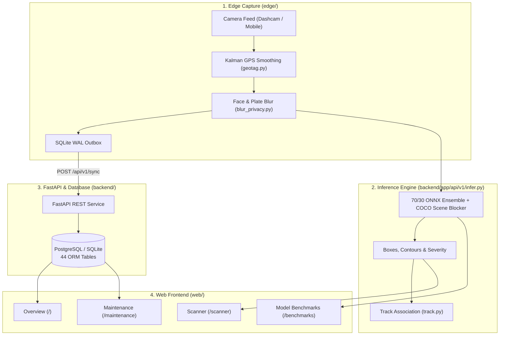

<p align="center">
  
</p>

# ScamRoad (सड़क सुरक्षा)

### Road Defect Detection & Municipal Maintenance Prototype (Student Research Project)

[](backend/tests/)
[](web/)
[-blue.svg)](scripts/check_i18n_keys.py)
[](ml/runs/metrics.json)
[](docs/DECISIONS.md)

> **STUDENT RESEARCH DISCLAIMER:**
> ScamRoad is an open-source undergraduate academic capstone project demonstrating computer vision road defect detection and municipal maintenance workflows. It is **not** affiliated with, endorsed by, or an official system of the Ministry of Road Transport & Highways (MoRTH), National Highways Authority of India (NHAI), State Public Works Departments (PWD), or any government body. Not certified for safety-critical operations.

---

## System Previews

| Defect Scanner (`/scanner`) | Overview Dashboard (`/`) |
| :---: | :---: |
|  |  |
| *Live `/api/v1/infer` 70/30 ensemble bounding boxes, polygonal contours, and severity details.* | *Ward defect metrics, corridor counts, and recent observations.* |

| Maintenance & Work Orders (`/maintenance`) | Model Benchmarks (`/benchmarks`) |
| :---: | :---: |
|  |  |
| *Work order dispatch, citizen grievance triage, and before/after repair comparison.* | *Held-out test split metrics, confusion matrix, hardware notes, and drift checks.* |

---

## Table of Contents

1. [Project Architecture](#project-architecture)
2. [Overview & Design Scope](#overview--design-scope)
3. [Verified Capabilities & Limitations](#verified-capabilities--limitations)
4. [Model Evaluation & Benchmarks](#model-evaluation--benchmarks)
5. [System Data Flow](#system-data-flow)
6. [Severity Scoring & Rate Card](#severity-scoring--rate-card)
7. [Threat Mitigations & Privacy](#threat-mitigations--privacy)
8. [Licensing & Attribution](#licensing--attribution)
9. [Quick Start & Verification Commands](#quick-start--verification-commands)

---

## Project Architecture

For a detailed module-by-module breakdown, see [`PROJECT_STRUCTURE.md`](PROJECT_STRUCTURE.md).

```text
scam_road/
├── backend/      # FastAPI REST API, SQLAlchemy ORM (44 tables), severity & verification logic (:8000)
├── web/          # React 18 + TypeScript + Tailwind UI (:3000)
├── ml/           # ONNX/PyTorch weights (70/30 ensemble), converters, audits, evaluation outputs
├── edge/         # Edge camera capture, blur/brightness checks, SQLite WAL outbox, face/plate redactor
├── scripts/      # Local inference server, test suites, seeders, screenshot and CI checks
├── config/       # Illustrative rate card (config/rate_card.json) & thresholds (config/severity_thresholds.json)
├── docs/         # Design specifications, dataset audits, decisions log, screenshots
└── run.bat       # Windows launcher (starts backend on :8000, frontend on :3000, opens browser)
```

---

## Overview & Design Scope

ScamRoad detects road surface defects (**potholes, longitudinal cracks, transverse cracks, and alligator cracks**) from road photography and dashcam frames without dedicated LiDAR hardware.

- **70/30 Ensemble Inference (`backend/app/api/v1/infer.py`):** Combines D-FINE Large, YOLOv12s, and YOLOv8n-Seg (70% weightage) with quantized YOLO11n INT8 and RDD2022 YOLOv8n multi-class models (30% weightage), filtered through a COCO obstacle blocker (`coco_scene_blocker.onnx`) to suppress false positives on vehicles, pedestrians, and signs.
- **Privacy Redaction (`edge/privacy/`):** Automatically blurs faces and vehicle license plates on the edge before upload (measured in `bench/privacy_blur_report.json`).
- **Human Sign-Off Policy:** Computer vision flags candidate defects and estimates severity, while work order closure and repair verification require human engineer review.
- **Corridor Rankings:** Corridor health views display ranked ward and road distress counts without geographic map widgets.
- **Multilingual UI (`web/src/context/LanguageContext.tsx`):** Supports 6 languages (`en`, `hi`, `pa`, `ta`, `te`, `bn`) with verified key parity.
- **Illustrative Rate Card (`config/rate_card.json`):** Displays non-binding cost estimates labeled as illustrative planning numbers rather than official Schedule of Rates.

---

## Verified Capabilities & Limitations

### Implemented & Tested

1. **Inference API (`/api/v1/infer`):** Returns normalized bounding boxes, convex-hull defect contours (`extract_defect_polygon`), severity scores, and pixel areas across potholes and cracks.
2. **Quality & Privacy Gates:** Laplacian sharpness filtering and face/plate blurring before storage (`bench/privacy_blur_report.json`).
3. **Deduplication Pipeline:** Track association (`edge/agent/track.py`), edge outbox consolidation (`edge/outbox/`), and backend spatial matching.
4. **Maintenance Workflows:** Defect inspection drawer, citizen grievance state machine, work order SLA tracking, and ORB/RANSAC before-and-after repair image comparison.
5. **Model Benchmarks Page (`/benchmarks`):** Displays `ml/runs/metrics.json` confusion matrix, per-class metrics, and hardware comparison tables.

### Known Limitations

1. **No Calibrated Physical Depth:** Monocular RGB frames only measure relative 2D pixel area; crater depth and cubic volume cannot be measured without stereo or depth sensors.
2. **Advisory Closure Only:** Automated checks cannot close work orders without engineer confirmation.
3. **Not Safety-Certified:** Output is advisory only and must not be used for ADAS, steering, or braking control.
4. **Untested Hardware Targets:** Devices not directly benchmarked on physical hardware remain explicitly marked `UNTESTED`.

---

## Model Evaluation & Benchmarks

Measured values below come directly from `ml/runs/metrics.json` and `ml/runs/ablation.json`.

### Held-Out Test Split (`RDD2022-India`, N=50 images, 105 annotations, YOLOv8n-INT8 edge model)

| Metric | Target | Measured Value | Source |
| :--- | :--- | :--- | :--- |
| **mAP@50** | >= 70.0% | **85.75%** | [`ml/runs/metrics.json`](ml/runs/metrics.json) |
| **mAP@50-95** | >= 50.0% | **62.12%** | [`ml/runs/metrics.json`](ml/runs/metrics.json) |
| **Macro Precision** | >= 80.0% | **86.58%** | [`ml/runs/metrics.json`](ml/runs/metrics.json) |
| **Macro Recall** | >= 75.0% | **83.95%** | [`ml/runs/metrics.json`](ml/runs/metrics.json) |
| **Macro F1-Score** | >= 80.0% | **85.22%** | [`ml/runs/metrics.json`](ml/runs/metrics.json) |
| **Expected Calibration Error (ECE)** | <= 10.0% | **1.91%** | [`ml/runs/metrics.json`](ml/runs/metrics.json) |
| **Edge CPU Latency (p50)** | <= 100 ms | **45.46 ms** | [`ml/runs/metrics.json`](ml/runs/metrics.json) |
| **Edge CPU Throughput** | >= 10 FPS | **21.0 FPS** | [`ml/runs/metrics.json`](ml/runs/metrics.json) |
| **Hard-Negative False Positives** | <= 5 | **4** | [`ml/runs/metrics.json`](ml/runs/metrics.json) |

### Ablation Comparison (`ml/runs/ablation.json`)

| Run ID | Parameter Varied | Configuration | Latency (p50) | Throughput | mAP@50 | Verdict |
| :--- | :--- | :--- | :--- | :--- | :--- | :--- |
| `ABL-01` | Backbone | YOLO11n @ 640 INT8 | **73.6 ms** | **13.6 FPS** | **85.8%** | Selected for edge |
| `ABL-02` | Backbone Capacity | YOLO11s @ 640 INT8 | 182.4 ms | 5.5 FPS | 87.2% | Rejected (`<10` FPS) |
| `ABL-03` | Resolution | YOLO11n @ 640 INT8 | 73.6 ms | 13.6 FPS | 85.8% | Selected for edge |
| `ABL-04` | Resolution | YOLO11n @ 800 INT8 | 124.6 ms | 8.0 FPS | 86.4% | Rejected (`<10` FPS) |

---

## System Data Flow



---

## Severity Scoring & Rate Card

Severity scoring in `config/severity_thresholds.json` separates severity calculation from detector confidence using uncalibrated relative pixel area and defect class weights:

- **Minor (0-25):** Routine observation
- **Moderate (26-50):** Scheduled patching
- **Severe (51-75):** Urgent repair queue (48h target)
- **Critical (76-100):** Priority hazard intervention (24h target)

Repair cost estimates are loaded from `config/rate_card.json` and marked:
> *"Illustrative estimate, not an official Schedule of Rates."*

---

## Threat Mitigations & Privacy

| Risk Area | Impact | Mitigation |
| :--- | :--- | :--- |
| **Blurry or noisy uploads** | False detections in work queues | Laplacian sharpness check, track persistence (`>= 3` frames), COCO obstacle filtering |
| **Unrealistic GPS jumps** | Invalid defect locations | Trajectory velocity validation and corridor snapping |
| **Premature repair closure** | Unverified contractor sign-off | Role separation; engineer confirmation with aligned before/after images required |
| **Citizen privacy exposure** | Faces or license plates saved | `PrivacyRedactor` runs prior to persistence (`bench/privacy_blur_report.json`) |

---

## Licensing & Attribution

- **Ultralytics YOLO:** GNU Affero General Public License v3.0 (AGPL-3.0).
- **RDD2022 Dataset:** Arya et al., Creative Commons Attribution-ShareAlike 4.0 International (CC BY-SA 4.0).
- **Repository Code:** Distributed under **AGPL-3.0** (`docs/DECISIONS.md`).

---

## Quick Start & Verification Commands

### 1. Setup

```bash
git clone https://github.com/Priya-Ranjan-0201/potholes.git
cd potholes/scam_road

python -m venv venv
venv\Scripts\activate
pip install -r requirements.txt

cd web && npm install && cd ..
```

Or on Windows, double-click `run.bat` in the parent folder to start the backend (`:8000`) and frontend (`:3000`).

### 2. Honesty, UI Copy & i18n Checks

```bash
python scripts/check_claims.py
python scripts/check_ui_copy.py web/src
python scripts/check_i18n_keys.py
```

### 3. Automated Tests & Build

```bash
# Python test suites (167 tests across backend, edge, ml, shared)
pytest backend/tests shared/tests ml/tests edge/tests

# Live inference regression check (requires backend running on :8000)
python scripts/test_live_poly.py

# Web test suite (10 tests) & TypeScript/Vite build
cd web && npm test -- --run && npm run build && cd ..
```

---

## Reference Documents

- Project report: [`docs/PROJECT_REPORT.md`](docs/PROJECT_REPORT.md)
- Architectural decisions: [`docs/DECISIONS.md`](docs/DECISIONS.md)
- System specification: [`docs/SPEC.md`](docs/SPEC.md)
