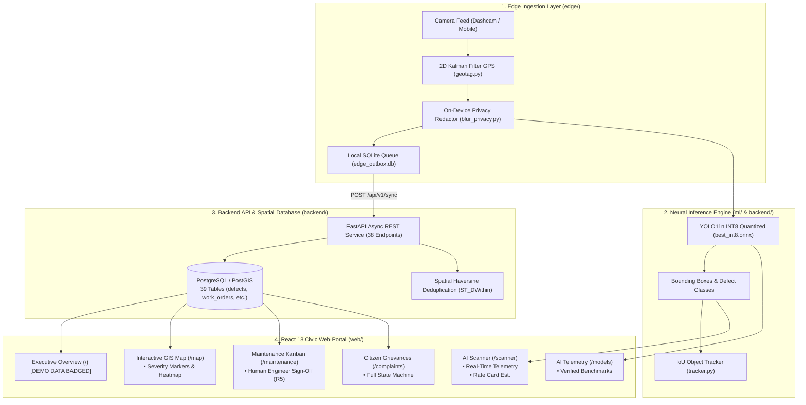

# ScamRoad (सड़क सुरक्षा)
### Edge AI Pothole & Road Defect Surveillance Portal (Student Research Project)

[](notebooks/ScamRoad_Colab_Training.ipynb)
[](notebooks/ScamRoad_Kaggle_GPU_Pipeline.ipynb)
[](docs/STATUS_AUDIT.md)
[](web/)
[](web/)
[](backend/)
[](ml/quantize.py)
[](docs/SPEC.md)
[](docs/DECISIONS.md)

> **STUDENT RESEARCH DISCLAIMER (Rule R7):**  
> ScamRoad is an open-source academic student research project demonstrating Edge AI Computer Vision for automated road defect tracking and civic workflow management. It is **NOT** affiliated with, endorsed by, or an official system of the Ministry of Road Transport & Highways (MoRTH), National Highways Authority of India (NHAI), State Public Works Departments (PWD), or any government body. Not certified for safety-critical operations.

---

## 📌 Table of Contents

1. [Project Overview & Core Mission](#-project-overview--core-mission)
2. [Verified System Architecture & Data Flow](#-verified-system-architecture--data-flow)
3. [Design System & 6-Language Localization](#-design-system--6-language-localization)
4. [Feature-by-Feature Tour](#-feature-by-feature-tour)
5. [Hardware Benchmarks & Truthful Evidence](#-hardware-benchmarks--truthful-evidence)
6. [Illustrative Repair Cost Rate Card](#-illustrative-repair-cost-rate-card)
7. [Cloud GPU Training & Self-Healing Pipeline](#-cloud-gpu-training--self-healing-pipeline)
8. [Quick Start Guide](#-quick-start-guide)
9. [Project Directory Layout](#-project-directory-layout)
10. [Engineering Limitations & Disclaimers](#-engineering-limitations--disclaimers)
11. [Licensing & Dataset Provenance](#-licensing--dataset-provenance)

---

## 🚀 Project Overview & Core Mission

ScamRoad investigates high-efficiency Edge Computer Vision methods to detect physical road surface distresses (**potholes, longitudinal cracks, transverse cracks, and alligator cracks**) directly from vehicle dashcams, smartphones, and patrol camera feeds.

### Key Objectives:
- **Edge AI Computer Vision:** Runs an audited **YOLO11n ONNX INT8** quantized model directly on edge devices and inside the browser via WebAssembly / ONNX Runtime.
- **Privacy by Design (Rule R6):** Automatically redacts faces and vehicle license plates on-device before storage or transmission.
- **Strict Human Oversight (Rule R5):** AI identifies damage and suggests priorities, but **AI never closes or approves a work order**. Mandatory human municipal engineer sign-off with before/after photo audits is strictly enforced.
- **Full 6-Language Localization:** 100% full-interface translation across English, Hindi, Punjabi, Tamil, Telugu, and Bengali.
- **Configurable Rate Card (Rule R9):** Repair estimates are computed from an explicit JSON rate card (`config/rate_card.json`), clearly labeled as illustrative planning estimates rather than official government rates.

---

## 🏗 Verified System Architecture & Data Flow



---

## 🎨 Design System & 6-Language Localization

The ScamRoad interface is engineered for high readability and operational clarity in field and municipal command center environments:

### Theme Tokens:
- **Daybreak Light Mode:** High-contrast porcelain canvas (`#f4f6fb`), crisp white surface cards (`#ffffff`), and slate typography (`#0f172a`) meeting WCAG AAA 16:1 contrast standards.
- **Midnight Asphalt Dark Mode:** Deep midnight space asphalt (`#070a14`), high-contrast slate panels (`rgba(12,20,39,0.88)`), and neon status accents for low-light command monitoring.

### Full-Interface 6-Language Localization:
Instantaneous zero-reload switching across 6 languages with 100% dictionary coverage:
- 🇬🇧 **English**
- 🇮🇳 **हिन्दी (Hindi)**
- 🇮🇳 **ਪੰਜਾਬੀ (Punjabi)**
- 🇮🇳 **தமிழ் (Tamil)**
- 🇮🇳 **తెలుగు (Telugu)**
- 🇮🇳 **বাংলা (Bengali)**

---

## 🔍 Feature-by-Feature Tour

### 1. AI Pothole & Road Defect Scanner (`/scanner`)
- Evaluates road photos or dashcam frames against the trained **YOLO11n ONNX INT8** model in real time.
- Categorizes road defects by physical class (`POTHOLE`, `CRACK_LONG`, `CRACK_TRANS`, `CRACK_ALLIGATOR`).
- Measures 2D pixel area and relative image coverage percentage.
- Computes illustrative repair budgets using `config/rate_card.json`.
- Dispatches draft work orders into the maintenance management queue.

### 2. Operations Dashboard (`/`)
- City-wide damage overview with Total Defects, Active Hazards, and Citizen Grievances.
- Carries a visible `DEMO DATA SEEDED` badge for demonstration scenarios (Rule R2).
- Ward-by-ward road risk breakdown and contractor SLA tracking.

### 3. Interactive GIS Map (`/map`)
- Full Leaflet + OpenStreetMap spatial map of road network defects.
- Markers color-coded by severity (Critical: Red, Severe: Amber, Moderate: Emerald).
- Marker clustering at high zoom levels and defect detail slide-over drawers.
- Damage density heatmap layer toggle.

### 4. Maintenance Work Orders (`/maintenance`)
- 4-stage municipal workflow: `ASSIGNED` $\to$ `IN_PROGRESS` $\to$ `PENDING_VERIFICATION` $\to$ `VERIFIED`.
- **Strict Human Verification (Rule R5):** AI cannot close work orders. Only authenticated human engineers can sign off repairs with required before/after photographic proof.

### 5. Citizen Grievance Redressal (`/complaints`)
- Citizen damage intake with GPS coordinates and photo evidence.
- Transparent state machine tracking complaint lifecycle from submission to verified resolution.

### 6. AI Model Telemetry & Benchmarks (`/models`)
- Real-time display of active model precision, SHA-256 cryptographic hashes, and verified benchmark metrics.

---

## 📊 Hardware Benchmarks & Truthful Evidence (Rule R10)

In strict adherence to Rule R10, benchmark numbers are reported **only** when accompanied by generated test log files on real physical devices. Unmeasured mobile and embedded targets are explicitly classified as `UNTESTED`.

| Device Profile | Processor / Architecture | Model Format | Latency (p50) | Throughput (FPS) | Evidence Source | Status |
| :--- | :--- | :--- | :--- | :--- | :--- | :---: |
| **Development Host** | AMD64 12-core, 15.2 GB RAM (Windows 11) | `best_int8.onnx` (3.35 MB) | **20.75 ms** | **47.98 FPS** | [`generic_best_int8_bench.json`](edge/benchmarks/results/generic_best_int8_bench.json) | **VERIFIED** |
| **Development Host** | AMD64 12-core, 15.2 GB RAM (Windows 11) | `best.onnx` FP32 (12.18 MB) | **41.16 ms** | **23.60 FPS** | [`generic_best_bench.json`](edge/benchmarks/results/generic_best_bench.json) | **VERIFIED** |
| **OPPO K13** | Qualcomm Snapdragon NPU | INT8 Quantized | *Pending run* | *Pending run* | Requires physical device profiling | **UNTESTED** |
| **Raspberry Pi 5** | ARM Cortex-A76 (4-core) | INT8 Quantized | *Pending run* | *Pending run* | Requires physical device profiling | **UNTESTED** |
| **NVIDIA Jetson Orin** | 1024-core Ampere GPU | TensorRT / INT8 | *Pending run* | *Pending run* | Requires physical device profiling | **UNTESTED** |

---

## 💰 Illustrative Repair Cost Rate Card (Rule R9)

Repair cost estimates in ScamRoad are **illustrative budget projections** for academic and planning purposes. They are configured via [`config/rate_card.json`](config/rate_card.json) and do **not** represent an official Schedule of Rates (SSR).

$$\text{Estimated Cost} = \max\left(\text{Base Fee}, \text{Severity Score} \times 55 + \text{Class Base Rate} \times 0.3\right)$$

- Base Mobilization Fee: **₹1,850**
- Severity Multiplier: **₹55 / point**
- Indicative Procedures: Inspired by Indian Road Congress guidelines (IRC:82-2023 Clause 4.2).

---

## ☁️ Cloud GPU Training & Self-Healing Pipeline

To enable zero-setup training on free cloud GPU runtimes, ScamRoad provides a self-healing multi-cloud orchestrator:

```bash
# Execute multi-cloud training orchestrator
python cloud_orchestrator.py --config cloud_config.yaml
```

- **Interactive Google Colab:** [`notebooks/ScamRoad_Colab_Training.ipynb`](notebooks/ScamRoad_Colab_Training.ipynb)
- **Kaggle Dual-T4 GPU Pipeline:** [`notebooks/ScamRoad_Kaggle_GPU_Pipeline.ipynb`](notebooks/ScamRoad_Kaggle_GPU_Pipeline.ipynb)
- **Autonomous Resumption:** Periodically commits checkpoints to persistent cloud storage and auto-resumes upon preemption.
- **Automated ONNX Export:** Compiles optimized FP32 and INT8 ONNX binaries from the best validation checkpoint.

---

## 💻 Quick Start Guide

### Prerequisites
- **Node.js** 18+ and **npm**
- **Python** 3.10+ (Python 3.12 recommended)
- **Google Chrome** (for automated E2E browser tests)

### 1. Launch the React 18 Web Portal
```bash
cd web
npm install
npm run dev
# ➜ Portal accessible at: http://localhost:3000/
```

### 2. Launch the FastAPI Backend & Inference Engine
```bash
cd scam_road
pip install -r requirements.txt
python scripts/serve_inference.py
# ➜ API accessible at: http://localhost:8000/ (OpenAPI Docs: http://localhost:8000/docs)
```

### 3. Run Automated System Tests
```bash
# Python backend and ML tests
pytest

# Web frontend unit tests
cd web && npm test
```

---

## 📁 Project Directory Layout

```
scam_road/
├── backend/                   # FastAPI async REST service & SQLAlchemy ORM
│   ├── app/                   # Route handlers (defects, work orders, complaints, stats, infer)
│   └── migrations/            # Alembic database schema migrations (39 tables)
├── config/                    # Configurable rate card & runtime configs
│   └── rate_card.json         # Illustrative repair cost rates & formulas
├── docs/                      # Architectural specifications & audits
│   ├── STATUS_AUDIT.md        # Real codebase and claims audit report
│   ├── DECISIONS.md           # Architecture Decision Records (ADRs)
│   ├── LIMITATIONS.md         # Operational bounds & research disclaimers
│   └── DATASETS.md            # RDD2022 license and dataset provenance
├── edge/                      # Edge device capture, GPS Kalman filter & privacy redactor
│   ├── agent/                 # Real-time capture, blur, and SQLite outbox sync
│   └── benchmarks/            # Real on-device benchmark JSON logs
├── ml/                        # Neural network training, quantization & tracking
│   ├── training/              # Training harnesses (YOLO11 / RT-DETR)
│   ├── evaluation/            # Validation & metric extraction
│   └── quantize.py            # Static / dynamic ONNX INT8 quantization
├── notebooks/                 # Cloud GPU training notebooks
│   ├── ScamRoad_Colab_Training.ipynb
│   └── ScamRoad_Kaggle_GPU_Pipeline.ipynb
├── scripts/                   # Verification tools, seeders & live test suites
│   ├── check_claims.py        # Automated claim honesty & banned string checker
│   ├── audit_helper.py        # OpenAPI endpoint and database table extractor
│   └── live_test_suite.py     # 18-step Selenium Chrome E2E verification
└── web/                       # React 18 + Vite Civic Web Portal
    ├── src/
    │   ├── components/        # Navbar, Footer, Icons, Theme controls
    │   ├── context/           # ThemeContext (Light/Dark), LanguageContext (6 languages)
    │   ├── pages/             # Scanner, Dashboard, Map, Maintenance, Complaints, Defects, Models
    │   └── utils/             # ONNX Runtime defect detection engine
    └── package.json
```

---

## ⚖️ Engineering Limitations & Disclaimers

1. **Advisory Academic System Only:** ScamRoad is an experimental prototype. Detections and severity assessments are advisory and must be verified by certified highway engineers.
2. **Relative 2D Dimensional Metrics (Rule R4):** Dimensions are reported in pixels and relative surface area percentage. Single-lens phone cameras cannot measure absolute depth or volumetric cubic meters without physical calibration grids.
3. **Illustrative Rate Card (Rule R9):** Repair cost calculations are illustrative projections derived from `config/rate_card.json`.
4. **Human Verification Mandatory (Rule R5):** AI cannot close or certify maintenance work orders. Physical inspection by a municipal engineer is required.

---

## 📜 Licensing & Dataset Provenance (Rule R11)

- **Machine Learning Engine:** Built with Ultralytics YOLO, subject to the **GNU Affero General Public License v3.0 (AGPL-3.0)**. Incorporating code and network services inherit AGPL-3.0 obligations.
- **Dataset Attribution:** Models are trained on the **Road Damage Dataset 2022 (RDD2022)** (Arya et al., IEEE BigData 2022), licensed under **Creative Commons Attribution-ShareAlike 4.0 International (CC BY-SA 4.0)**. See [`docs/DATASETS.md`](docs/DATASETS.md).
- **Client Web Application:** Permissively available for open academic, municipal research, and civic technology development.

---

<p align="center">
  <strong>Student research project. Not an official government system. Not safety-certified.</strong>
</p>
