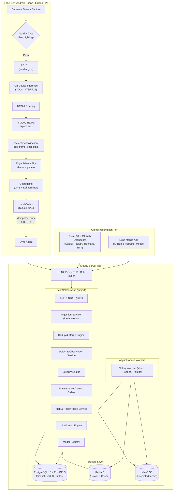

# ScamRoad — Architecture Document

> *"Deploying advanced space technology to map road craters so deep you don't need a rocket to visit the Moon."*  
> *(Branding tagline only — never in code, API fields, or technical depth claims)*

---

## 1. System Overview

ScamRoad is a pothole-first, edge-deployed road-damage tracking system. It transforms standard camera-equipped edge hardware (Android phones like the OPPO K13, laptops, and edge single-board computers) into active road-condition sensors.

Detection and tracking execute **on the edge device**, tracking physical defects across frames, extracting geotags with GPS accuracy estimation, blurring privacy-sensitive regions (faces, license plates) before persistent storage, queuing sightings offline in an ACID SQLite outbox, and synchronizing with an idempotent cloud backend when network connectivity is available.

The backend performs geospatial deduplication across devices and passes, clusters defects, computes severity scores, manages work orders, verifies repairs via advisory AI comparison, and aggregates the **ScamRoad Health Index**.

---

## 2. System Architecture Diagram

---

## 3. Component Breakdown

### 3.1 Edge Agent (`edge/`)
- **`edge/agent/capture.py`**: Non-blocking frame capture ring-buffer with thermal/FPS throttling.
- **`edge/agent/infer.py`**: ONNX Runtime / TFLite runtime for edge inference.
- **`edge/agent/track.py`**: In-video ByteTrack with vehicle ego-motion gating.
- **`edge/agent/blur_privacy.py`**: Automatic blurring of faces and vehicle license plates before local storage.
- **`edge/agent/geotag.py`**: GPS extraction, Kalman smoothing, and accuracy filtering.
- **`edge/agent/outbox.py`**: ACID SQLite outbox with WAL mode, exponential backoff, and crash recovery.
- **`edge/agent/sync.py`**: Idempotent batch sync to `/api/v1/sync`.

### 3.2 ML Pipeline (`ml/`)
- **`ml/data/audit.py`**: Dataset verification, perceptual hashing, split leakage checks, class distributions.
- **`ml/data/convert.py`**: Unified annotation conversion mapping sources to `shared/taxonomy.yaml`.
- **`ml/training/train.py`**: Ultralytics YOLOv8 training with mixed precision, ablations, and hard-negative mining.
- **`ml/export/export_onnx.py`**: Exporting to ONNX and TFLite with pinned opsets.
- **`ml/quantization/quantize.py`**: Post-training quantization (INT8) calibrated on real road imagery.
- **`ml/evaluation/evaluate.py`**: Metric reporting (mAP@50, mAP@50-95, PR curves, confusion matrices).

### 3.3 Backend API (`backend/`)
- **FastAPI Core**: Built on Python 3.12 with full async/await architecture.
- **PostgreSQL 16 + PostGIS 3**: 39 relational tables, GiST spatial indexing on geography points and linestrings.
- **Deduplication Engine**: Distance matching via `ST_DWithin` parameterized by GPS accuracy, heading, and image hash.
- **Severity Engine**: Multi-factor scoring with automatic renormalisation over available factors.
- **State Machines**: Enforced complaint and work order lifecycle transitions.

### 3.4 Shared Schemas & Taxonomy (`shared/`)
- **`shared/taxonomy.yaml`**: The single source of truth for damage classes across ML, edge, and backend.
- **`shared/json-schemas/`**: Pydantic and JSON Schema contracts for `detection`, `defect`, `observation`, and `sync-batch`.

### 3.5 Web & Mobile (`web/` & `mobile/`)
- **Web**: React 18, TypeScript, Tailwind CSS, TanStack Query, Ward Hotspot Grid, ranked corridor analytics, and external navigation links.
- **Mobile**: Expo SDK with Citizen mode (GPS manual pin, reports, upvoting) and Inspector Drive mode.

---

## 4. One Pothole = One Record Guarantee

ScamRoad implements a 3-level consolidation and deduplication guarantee:

1. **In-Video Tracking (Level 1)**: ByteTrack assigns persistent track IDs across contiguous frames.
2. **Defect Consolidation (Level 2)**: The edge agent consolidates each track into a single `defect_candidate`, computing median measurements and selecting the highest quality frame. Tracks under minimum frame length are rejected as false alarms.
3. **Cross-Pass / Cross-Device Dedup (Level 3)**: The backend matches incoming observations to canonical `defects` using PostGIS spatial proximity (`ST_DWithin`), heading comparison, road segment matching, and perceptual image hash. Merges are logged in `defect_merge_log` and remain reversible.
