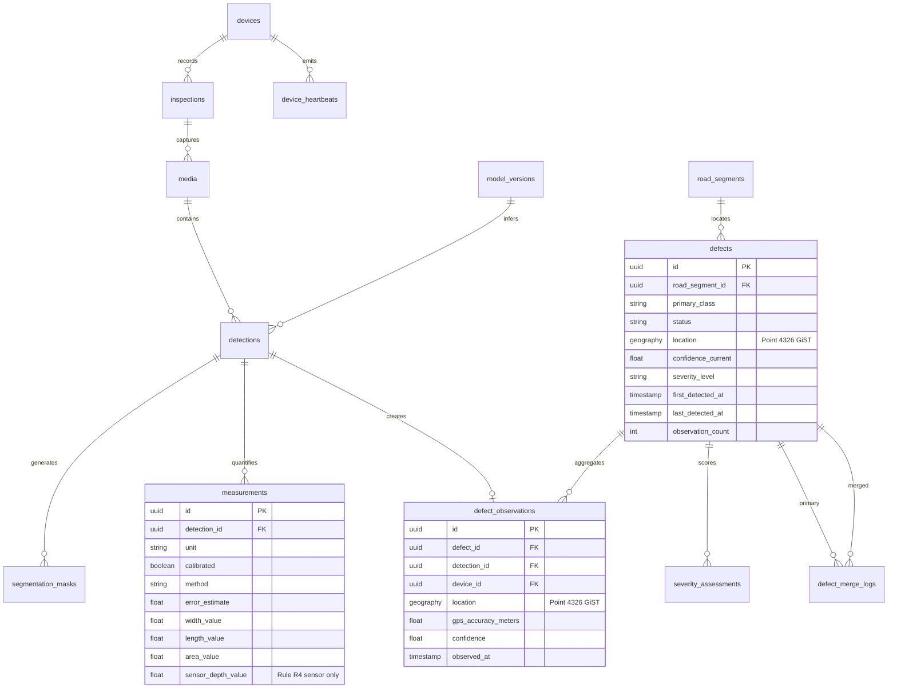
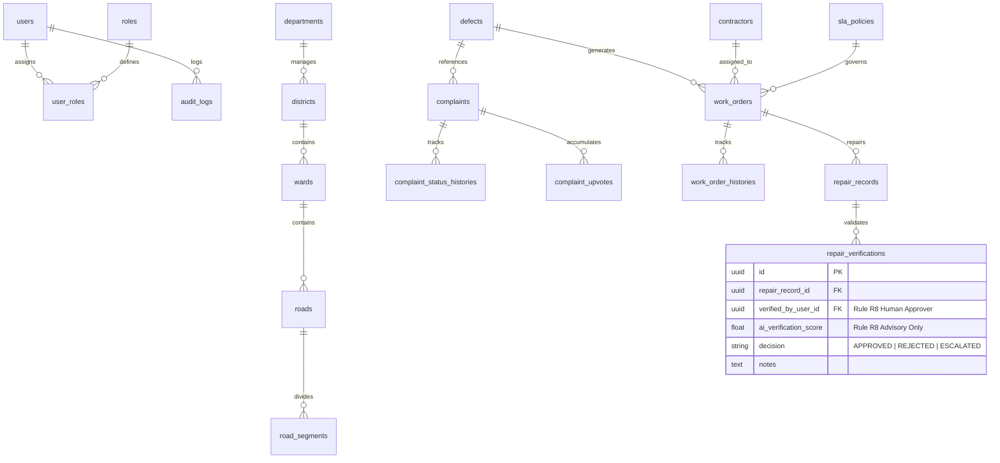

# ScamRoad Database Schema & Entity Relationship Documentation (ERD)

**Database Engine**: PostgreSQL 16 + PostGIS 3  
**ORM**: SQLAlchemy 2.0 (Declarative Mapped Dataclass style)  
**Total Tables**: 39 tables across 8 core domain modules  
**Coordinate Reference System**: WGS 84 (`EPSG:4326`)  
- Point Defects & Observations: `geography(POINT, 4326)` for geodesic meter-distance spatial queries (`ST_DWithin`).
- Linear Road Networks: `geometry(LINESTRING, 4326)` for road segment geometries with spatial GiST indexing.

---

## 1. Domain Module Overview

| Module | Table Count | Tables |
|---|---|---|
| **Auth & Security** | 4 | `users`, `roles`, `user_roles`, `audit_logs` |
| **Geospatial Infrastructure** | 5 | `departments`, `districts`, `wards`, `roads`, `road_segments` |
| **Device & Edge Telemetry** | 2 | `devices`, `device_heartbeats` |
| **ML & Computer Vision** | 6 | `model_versions`, `inspections`, `media`, `detections`, `segmentation_masks`, `measurements` |
| **Defect & Spatial Analytics** | 5 | `defects`, `defect_observations`, `defect_merge_logs`, `severity_assessments`, `road_health_scores` |
| **Citizen Engagement** | 4 | `citizen_reports`, `complaints`, `complaint_status_histories`, `complaint_upvotes` |
| **Maintenance & Operations** | 7 | `contractors`, `sla_policies`, `work_orders`, `work_order_histories`, `repair_records`, `repair_verifications`, `budget_allocations` |
| **Analytics & Automation** | 6 | `weather_records`, `forecasts`, `notifications`, `notification_rules`, `report_jobs`, `system_settings` |

---

## 2. Mermaid Entity Relationship Diagrams

### 2.1 Core Defect, ML Detection & Spatial Relationships

### 2.2 Maintenance Operations, Citizen Complaints & Governance

---

## 3. Detailed Table Schema Definitions

### 3.1 Auth & Security

#### `users`
- `id` (UUID, PK)
- `email` (VARCHAR 255, UNIQUE, NOT NULL, INDEX)
- `hashed_password` (VARCHAR 255, NOT NULL) - Argon2id hashes
- `full_name` (VARCHAR 255, NOT NULL)
- `is_active` (BOOLEAN, DEFAULT TRUE, NOT NULL)
- `is_superuser` (BOOLEAN, DEFAULT FALSE, NOT NULL)
- `created_at`, `updated_at` (TIMESTAMPTZ)

#### `roles`
- `id` (UUID, PK)
- `name` (VARCHAR 50, UNIQUE, NOT NULL) - `SUPER_ADMIN`, `ROAD_ENGINEER`, `MAINTENANCE_SUPERVISOR`, `INSPECTOR`, `CITIZEN`
- `description` (TEXT)
- `created_at`, `updated_at` (TIMESTAMPTZ)

#### `user_roles`
- `id` (UUID, PK)
- `user_id` (UUID, FK `users.id` ON DELETE CASCADE, INDEX)
- `role_id` (UUID, FK `roles.id` ON DELETE CASCADE, INDEX)
- UNIQUE constraint on `(user_id, role_id)`

#### `audit_logs` (Append-Only Immutable Ledger)
- `id` (UUID, PK)
- `user_id` (UUID, FK `users.id` ON DELETE SET NULL, INDEX)
- `action` (VARCHAR 100, NOT NULL, INDEX)
- `resource_type` (VARCHAR 100, NOT NULL, INDEX)
- `resource_id` (VARCHAR 100, NOT NULL, INDEX)
- `payload_before` (JSONB)
- `payload_after` (JSONB)
- `ip_address` (VARCHAR 45)
- `user_agent` (TEXT)
- `created_at` (TIMESTAMPTZ, NOT NULL)

---

### 3.2 Geospatial Infrastructure

#### `departments`
- `id` (UUID, PK)
- `name` (VARCHAR 200, UNIQUE, NOT NULL)
- `code` (VARCHAR 50, UNIQUE, NOT NULL)

#### `districts`
- `id` (UUID, PK)
- `department_id` (UUID, FK `departments.id` ON DELETE CASCADE)
- `name` (VARCHAR 200, NOT NULL)
- `code` (VARCHAR 50, NOT NULL)

#### `wards`
- `id` (UUID, PK)
- `district_id` (UUID, FK `districts.id` ON DELETE CASCADE)
- `name` (VARCHAR 200, NOT NULL)
- `ward_number` (INTEGER, NOT NULL)

#### `roads`
- `id` (UUID, PK)
- `ward_id` (UUID, FK `wards.id` ON DELETE CASCADE)
- `name` (VARCHAR 255, NOT NULL)
- `road_number` (VARCHAR 100, INDEX)
- `surface_type` (VARCHAR 50, NOT NULL) - `ASPHALT`, `CONCRETE`, `PAVED`, `UNPAVED`

#### `road_segments`
- `id` (UUID, PK)
- `road_id` (UUID, FK `roads.id` ON DELETE CASCADE, INDEX)
- `segment_code` (VARCHAR 100, NOT NULL)
- `geometry` (GEOMETRY(LINESTRING, 4326), NOT NULL) - **Spatial GiST Index**: `idx_road_segments_geom_gist`
- `length_meters` (FLOAT, NOT NULL)
- `lane_count` (INTEGER, DEFAULT 2)
- `speed_limit_kmh` (INTEGER, DEFAULT 40)

---

### 3.3 Hardware Devices & Telemetry

#### `devices`
- `id` (UUID, PK)
- `device_uid` (VARCHAR 100, UNIQUE, NOT NULL, INDEX) - Android hardware UID or Pi MAC
- `device_type` (VARCHAR 50, NOT NULL) - `ANDROID_MOBILE`, `RASPBERRY_PI_4`, `JETSON_ORIN_NANO`
- `hardware_specs` (JSONB) - RAM, NPU/GPU model, camera resolution
- `api_key_hash` (VARCHAR 255, NOT NULL)
- `is_active` (BOOLEAN, DEFAULT TRUE)
- `last_heartbeat_at` (TIMESTAMPTZ)

#### `device_heartbeats` (Append-Only Telemetry)
- `id` (UUID, PK)
- `device_id` (UUID, FK `devices.id` ON DELETE CASCADE, INDEX)
- `battery_level` (FLOAT)
- `storage_free_mb` (FLOAT)
- `cpu_temp_celsius` (FLOAT)
- `fps` (FLOAT) - Edge detection loop FPS
- `inference_latency_ms` (FLOAT) - ONNX/TFLite latency
- `created_at` (TIMESTAMPTZ, NOT NULL, INDEX)

---

### 3.4 ML Pipeline & Computer Vision

#### `model_versions`
- `id` (UUID, PK)
- `model_name` (VARCHAR 100, NOT NULL) - `yolov8n-scamroad`, `yolov8s-scamroad`
- `version` (VARCHAR 50, NOT NULL)
- `framework` (VARCHAR 50, NOT NULL) - `ONNX`, `TFLITE_INT8`, `TENSORRT`
- `input_shape` (VARCHAR 50, NOT NULL) - `[1, 3, 640, 640]`
- `metrics` (JSONB, NOT NULL) - `mAP50`, `mAP50-95`, `latency_ms`
- `storage_path` (VARCHAR 500, NOT NULL)
- `is_active` (BOOLEAN, DEFAULT FALSE)

#### `inspections`
- `id` (UUID, PK)
- `device_id` (UUID, FK `devices.id` ON DELETE SET NULL)
- `surveyor_user_id` (UUID, FK `users.id` ON DELETE SET NULL)
- `title` (VARCHAR 200, NOT NULL)
- `status` (VARCHAR 50, NOT NULL) - `IN_PROGRESS`, `COMPLETED`, `FAILED`
- `start_time`, `end_time` (TIMESTAMPTZ)
- `distance_meters` (FLOAT, DEFAULT 0.0)

#### `media`
- `id` (UUID, PK)
- `inspection_id` (UUID, FK `inspections.id` ON DELETE SET NULL)
- `device_id` (UUID, FK `devices.id` ON DELETE SET NULL)
- `media_type` (VARCHAR 50, NOT NULL) - `IMAGE_FRAME`, `CROPPED_PATCH`, `SHORT_VIDEO`
- `storage_uri` (VARCHAR 500, NOT NULL) - MinIO/S3 object key
- `sha256_hash` (VARCHAR 64, NOT NULL)
- `file_size_bytes` (INTEGER, NOT NULL)
- `width_px`, `height_px` (INTEGER, NOT NULL)
- `faces_blurred` (BOOLEAN, DEFAULT FALSE) - **Rule R15 Privacy by Design**
- `plates_blurred` (BOOLEAN, DEFAULT FALSE) - **Rule R15 Privacy by Design**

#### `detections`
- `id` (UUID, PK)
- `media_id` (UUID, FK `media.id` ON DELETE CASCADE, INDEX)
- `model_version_id` (UUID, FK `model_versions.id` ON DELETE RESTRICT)
- `class_name` (VARCHAR 50, NOT NULL) - Mapped to `shared/taxonomy.yaml`
- `confidence` (FLOAT, NOT NULL) - **Rule R5: Confidence separated from severity**
- `bbox_x1`, `bbox_y1`, `bbox_x2`, `bbox_y2` (FLOAT, NOT NULL)
- `tracking_id` (VARCHAR 100, INDEX) - ByteTrack defect trajectory identifier

#### `segmentation_masks`
- `id` (UUID, PK)
- `detection_id` (UUID, FK `detections.id` ON DELETE CASCADE, INDEX)
- `polygon_points` (JSONB) - Normalized polygon contour `[[x1, y1], [x2, y2], ...]`
- `area_pixels` (FLOAT, NOT NULL)
- `relative_road_area_ratio` (FLOAT)

#### `measurements` (Physical Dimensions - Strict Rule R4 Compliance)
- `id` (UUID, PK)
- `detection_id` (UUID, FK `detections.id` ON DELETE CASCADE, INDEX)
- `unit` (VARCHAR 20, NOT NULL) - `px`, `cm`, `m`, `relative`
- `calibrated` (BOOLEAN, DEFAULT FALSE, NOT NULL) - **Rule R4**: FALSE for uncalibrated single frames
- `method` (VARCHAR 100) - `ground_homography`, `depth_sensor`, `reference_marker`, `none`
- `error_estimate` (FLOAT) - Estimated margin of error in specified units
- `width_value` (FLOAT)
- `length_value` (FLOAT)
- `area_value` (FLOAT)
- `sensor_depth_value` (FLOAT) - **Rule R4**: Sensor-measured depth only; never estimated from 2D pixels

---

### 3.5 Defect Management & Spatial Analytics

#### `defects` (Physical Persistent Defect Entities)
- `id` (UUID, PK)
- `road_segment_id` (UUID, FK `road_segments.id` ON DELETE SET NULL, INDEX)
- `primary_class` (VARCHAR 50, NOT NULL, INDEX)
- `status` (VARCHAR 50, NOT NULL, INDEX) - `DETECTED`, `VERIFIED`, `SCHEDULED`, `REPAIRED`, `CLOSED`, `REJECTED`
- `location` (GEOGRAPHY(POINT, 4326), NOT NULL) - **Spatial GiST Index**: `idx_defects_location_gist`
- `confidence_current` (FLOAT, NOT NULL)
- `severity_level` (VARCHAR 50, NOT NULL) - `LOW`, `MEDIUM`, `HIGH`, `CRITICAL`
- `first_detected_at`, `last_detected_at` (TIMESTAMPTZ, NOT NULL)
- `observation_count` (INTEGER, DEFAULT 1, NOT NULL)

#### `defect_observations` (Append-Only Observation History)
- `id` (UUID, PK)
- `defect_id` (UUID, FK `defects.id` ON DELETE CASCADE, INDEX)
- `detection_id` (UUID, FK `detections.id` ON DELETE SET NULL)
- `device_id` (UUID, FK `devices.id` ON DELETE SET NULL)
- `location` (GEOGRAPHY(POINT, 4326), NOT NULL) - **Spatial GiST Index**: `idx_defect_observations_location_gist`
- `gps_accuracy_meters` (FLOAT, NOT NULL)
- `confidence` (FLOAT, NOT NULL)
- `observed_at` (TIMESTAMPTZ, NOT NULL, INDEX)

#### `defect_merge_logs`
- `id` (UUID, PK)
- `primary_defect_id` (UUID, FK `defects.id` ON DELETE CASCADE, INDEX)
- `merged_defect_id` (UUID, FK `defects.id` ON DELETE CASCADE, INDEX)
- `distance_meters` (FLOAT, NOT NULL)
- `reason` (VARCHAR 200, NOT NULL)
- `created_at` (TIMESTAMPTZ, NOT NULL)

#### `severity_assessments`
- `id` (UUID, PK)
- `defect_id` (UUID, FK `defects.id` ON DELETE CASCADE, INDEX)
- `score` (FLOAT, NOT NULL) - Computed severity index (0.0 to 100.0)
- `level` (VARCHAR 50, NOT NULL) - `LOW`, `MEDIUM`, `HIGH`, `CRITICAL`
- `factors` (JSONB, NOT NULL) - Factor contributions (area, traffic density, road class, weather history)
- `missing_factors` (JSONB) - **Rule R7**: Explicit list of missing variables; score renormalized
- `assessed_at` (TIMESTAMPTZ, NOT NULL)

#### `road_health_scores`
- `id` (UUID, PK)
- `road_segment_id` (UUID, FK `road_segments.id` ON DELETE CASCADE, INDEX)
- `pci_score` (FLOAT, NOT NULL) - Pavement Condition Index (0.0 to 100.0)
- `defect_density` (FLOAT, NOT NULL) - Defects per kilometer
- `calculated_at` (TIMESTAMPTZ, NOT NULL, INDEX)

---

### 3.6 Citizen Engagement

#### `citizen_reports`
- `id` (UUID, PK)
- `reporter_user_id` (UUID, FK `users.id` ON DELETE SET NULL)
- `location` (GEOGRAPHY(POINT, 4326), NOT NULL)
- `description` (TEXT)
- `media_uri` (VARCHAR 500)
- `reported_at` (TIMESTAMPTZ, NOT NULL)

#### `complaints`
- `id` (UUID, PK)
- `defect_id` (UUID, FK `defects.id` ON DELETE SET NULL, INDEX)
- `citizen_report_id` (UUID, FK `citizen_reports.id` ON DELETE SET NULL)
- `ticket_number` (VARCHAR 50, UNIQUE, NOT NULL, INDEX)
- `status` (VARCHAR 50, NOT NULL) - `SUBMITTED`, `ACKNOWLEDGED`, `IN_REVIEW`, `SCHEDULED`, `RESOLVED`, `CLOSED`
- `priority` (VARCHAR 50, DEFAULT 'NORMAL')

#### `complaint_status_histories`
- `id` (UUID, PK)
- `complaint_id` (UUID, FK `complaints.id` ON DELETE CASCADE, INDEX)
- `from_status` (VARCHAR 50, NOT NULL)
- `to_status` (VARCHAR 50, NOT NULL)
- `changed_by_user_id` (UUID, FK `users.id` ON DELETE SET NULL)
- `note` (TEXT)

#### `complaint_upvotes`
- `id` (UUID, PK)
- `complaint_id` (UUID, FK `complaints.id` ON DELETE CASCADE, INDEX)
- `user_id` (UUID, FK `users.id` ON DELETE CASCADE)
- UNIQUE constraint on `(complaint_id, user_id)`

---

### 3.7 Maintenance & Operations

#### `contractors`
- `id` (UUID, PK)
- `name` (VARCHAR 255, NOT NULL)
- `contact_email` (VARCHAR 255, NOT NULL)
- `phone` (VARCHAR 50, NOT NULL)
- `license_number` (VARCHAR 100, UNIQUE, NOT NULL)
- `rating` (FLOAT, DEFAULT 5.0)

#### `sla_policies`
- `id` (UUID, PK)
- `severity_level` (VARCHAR 50, UNIQUE, NOT NULL) - `CRITICAL`, `HIGH`, `MEDIUM`, `LOW`
- `resolution_hours` (INTEGER, NOT NULL) - e.g., Critical = 24h, High = 48h, Medium = 168h
- `warning_hours` (INTEGER, NOT NULL)

#### `work_orders`
- `id` (UUID, PK)
- `defect_id` (UUID, FK `defects.id` ON DELETE RESTRICT, INDEX)
- `contractor_id` (UUID, FK `contractors.id` ON DELETE SET NULL, INDEX)
- `order_number` (VARCHAR 50, UNIQUE, NOT NULL, INDEX)
- `status` (VARCHAR 50, NOT NULL) - `DRAFT`, `ASSIGNED`, `IN_PROGRESS`, `AWAITING_VERIFICATION`, `COMPLETED`, `CANCELLED`
- `budget_allocated` (FLOAT)
- `deadline` (TIMESTAMPTZ, NOT NULL)

#### `work_order_histories`
- `id` (UUID, PK)
- `work_order_id` (UUID, FK `work_orders.id` ON DELETE CASCADE, INDEX)
- `status` (VARCHAR 50, NOT NULL)
- `notes` (TEXT)

#### `repair_records`
- `id` (UUID, PK)
- `work_order_id` (UUID, FK `work_orders.id` ON DELETE CASCADE, INDEX)
- `repair_method` (VARCHAR 100, NOT NULL) - `HOT_MIX_ASPHALT`, `COLD_PATCH`, `FULL_DEPTH_RECLAMATION`
- `materials_used` (JSONB)
- `after_media_uri` (VARCHAR 500, NOT NULL) - Photo evidence of repaired road
- `cost_incurred` (FLOAT, NOT NULL)
- `completed_at` (TIMESTAMPTZ, NOT NULL)

#### `repair_verifications` (Rule R8: Human in the loop, AI advisory only)
- `id` (UUID, PK)
- `repair_record_id` (UUID, FK `repair_records.id` ON DELETE CASCADE, INDEX)
- `verified_by_user_id` (UUID, FK `users.id` ON DELETE SET NULL) - **Rule R8: Human authority closes work order**
- `ai_verification_score` (FLOAT) - **Rule R8: AI advisory confidence (0.0 to 1.0)**
- `ai_model_version` (VARCHAR 50)
- `decision` (VARCHAR 50, NOT NULL) - `APPROVED`, `REJECTED`, `RE_INSPECTION_REQUIRED`
- `notes` (TEXT)
- `verified_at` (TIMESTAMPTZ, NOT NULL)

#### `budget_allocations`
- `id` (UUID, PK)
- `department_id` (UUID, FK `departments.id` ON DELETE CASCADE, INDEX)
- `fiscal_year` (VARCHAR 20, NOT NULL)
- `total_budget` (FLOAT, NOT NULL)
- `allocated_budget` (FLOAT, DEFAULT 0.0)
- `spent_budget` (FLOAT, DEFAULT 0.0)

---

### 3.8 Environmental Analytics & System Config

#### `weather_records`
- `id` (UUID, PK)
- `district_id` (UUID, FK `districts.id` ON DELETE CASCADE, INDEX)
- `recorded_at` (TIMESTAMPTZ, NOT NULL, INDEX)
- `rainfall_mm` (FLOAT, DEFAULT 0.0)
- `temperature_celsius` (FLOAT)

#### `forecasts` (Rule R6: Strictly distinct from observations)
- `id` (UUID, PK)
- `road_segment_id` (UUID, FK `road_segments.id` ON DELETE CASCADE, INDEX)
- `forecast_date` (TIMESTAMPTZ, NOT NULL, INDEX)
- `predicted_pci` (FLOAT, NOT NULL)
- `confidence_interval_low` (FLOAT, NOT NULL)
- `confidence_interval_high` (FLOAT, NOT NULL)
- `model_version` (VARCHAR 50, NOT NULL) - e.g., `deterioration-v1.0`
- `generated_at` (TIMESTAMPTZ, NOT NULL)

#### `notifications` & `notification_rules`
- `id` (UUID, PK)
- User alert delivery, event triggers (SLA breaches, severe new defects), and delivery channels (`EMAIL`, `SMS`, `IN_APP`).

#### `report_jobs`
- `id` (UUID, PK)
- Asynchronous Celery export tracking (`PDF`, `GEOJSON`, `CSV`).

#### `system_settings`
- `id` (UUID, PK)
- Key-value configuration store with JSON values.

---

## 4. Spatial Indexes & Performance Optimization

To ensure sub-50ms query latencies for edge syncing, bounding box queries, and spatial deduplication, the following GiST indexes are explicitly defined:
1. `CREATE INDEX idx_defects_location_gist ON defects USING gist (location);`
2. `CREATE INDEX idx_defect_observations_location_gist ON defect_observations USING gist (location);`
3. `CREATE INDEX idx_road_segments_geom_gist ON road_segments USING gist (geometry);`
4. `CREATE INDEX idx_outbox_events_status_priority ON outbox_events (status, priority DESC, created_at ASC);` (Edge SQLite WAL Outbox)
