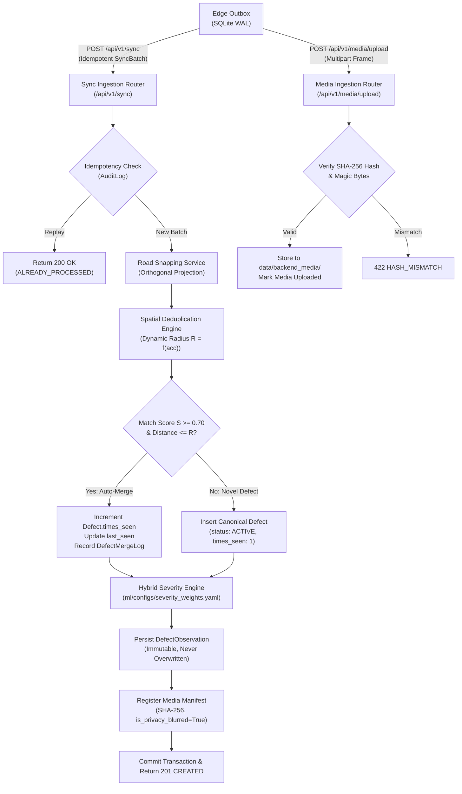

# Phase 6 Implementation Report: Cloud Ingestion, Spatial Snapping, Deduplication & Severity Engine

```
PROJECT ID   : ScamRoad (scam_road)
PHASE        : Phase 6 — Cloud Ingestion, Spatial Snapping, Deduplication & Severity Engine
STATUS       : COMPLETED & VERIFIED
DATE         : 2026-10-31
COMPLIANCE   : Rules R1, R2, R4, R5, R6, R7, R8, R9, R10, R15; SPEC B4, B5, B6, B7, B8
```

---

## 1. What Was Built

Phase 6 implements the centralized cloud ingestion and spatial processing intelligence layer connecting distributed edge agents to the PostgreSQL/PostGIS database.



### Module Breakdown:
1. **Configurable Hybrid Severity Engine (`ml/severity/engine.py` & `backend/app/services/severity.py`)**:
   - Strictly obeys Rule R5 (confidence $\ne$ severity) and Rule R7 (missing data is NULL, never invented).
   - Dynamic weight renormalization formula:
     $$\text{raw} = \sum_{i \in \text{available}} w_i f_i, \quad \text{score} = 100.0 \times \frac{\text{raw}}{\sum_{i \in \text{available}} w_i}$$
   - Evaluates base hazard risk (`POTHOLE`: 0.85, `CRACK_ALLIGATOR`: 0.65, etc.), relative area (% of road ROI), recurrence density, confidence, POI proximity, and rainfall exposure.
   - Categorizes severity into `Minor` (0–25), `Moderate` (26–50), `Severe` (51–75), and `Critical` (76–100) with SLA hours and recommended maintenance actions.
   - Rule B6 review triggers flag low confidence ($< 0.40$), short tracks ($< 3$ frames), or abnormal area ($> 15\%$) for human review without distorting score.
2. **Road Snapping & Spatial Projection (`backend/app/services/roads.py`)**:
   - Geodesic distance calculation via Great Circle haversine formula.
   - Local metric projection computing perpendicular distance from coordinates to road segment LineStrings.
   - Snaps defects within 50 meters to road segments and links `defect.road_segment_id`.
   - Seed function initializing Grand Trunk Road (NH-44) and Ferozepur Road corridors for tests and demos.
3. **Spatial Deduplication & Merging Service (`backend/app/services/dedup.py`)**:
   - Enforces the "One Pothole = One Record" guarantee (SPEC B5).
   - Dynamic search radius $R = \max(10.0, \min(30.0, 1.5 \times \text{gps\_accuracy\_m}))$.
   - Multi-metric composite match score:
     $$S = 0.50 \cdot S_{\text{dist}} + 0.35 \cdot S_{\text{class}} + 0.15 \cdot S_{\text{heading}}$$
   - Auto-merges observations with $S \ge 0.70$ and $d \le R$, updating `Defect.times_seen` and `Defect.last_seen`.
   - Records all merge rationale, scores, and distances in `defect_merge_log` for complete auditability.
   - Creates new canonical `Defect` records for novel sightings ($S < 0.50$ or no defect within $R$).
   - Inserts immutable `DefectObservation` records (never overwritten).
4. **Sync Batch Ingestion API (`backend/app/api/v1/sync.py`)**:
   - Endpoint: `POST /api/v1/sync`.
   - Accepts `SyncBatchRequest` conforming to `sync-batch.schema.json`.
   - Enforces strict idempotency via `AuditLog` lookup: duplicate requests return `200 OK` with `status="ALREADY_PROCESSED"` and cached counts without re-inserting records.
   - Auto-registers edge devices and links survey inspections.
5. **Media Upload & Verification API (`backend/app/api/v1/media.py`)**:
   - Endpoint: `POST /api/v1/media/upload`.
   - Validates uploaded bytes against client manifest SHA-256 hash.
   - Validates image magic bytes (JPEG/PNG) and saves verified files to `data/backend_media/`.
6. **Defect Management & Map APIs (`backend/app/api/v1/defects.py`, `backend/app/api/v1/map.py`)**:
   - `GET /api/v1/defects`: Paginated defect listing with filtering by status, class_code, and min_severity.
   - `GET /api/v1/defects/{defect_id}`: Comprehensive lifecycle detail with all observations, severity history, and merge logs.
   - `POST /api/v1/defects/{defect_id}/override-severity`: Rule B6 human override endpoint with audit tracking.
   - `GET /api/v1/map/geojson`: FeatureCollection of Point geometries formatted for Leaflet/React maps with bounding-box filtering.
   - `GET /api/v1/map/roads`: LineString features for road networks.

---

## 2. Verification Evidence

### 2.1 Live Edge-to-Cloud Sync Execution (`python scripts/live_sync_demo.py`)
```
=== SCAMROAD PHASE 6: LIVE EDGE-TO-CLOUD SYNC VERIFICATION ===
[Outbox Before Sync] Pending: 6 | Total: 6

[Edge Sync] Initiating HTTP POST /api/v1/sync to http://127.0.0.1:8000...
[Edge Sync Result] Status: SYNCED | Synced: 6 | Failed: 0
[Outbox After Sync] Pending: 0 | Completed: 6

[Backend Verification] Fetching canonical defects from http://127.0.0.1:8000/api/v1/defects...
[Backend Defects] Total Canonical Defects Ingested: 7
  - Defect [POTHOLE] ID=bbd42102-1c57-4485-a5c7-ad1efc144d4c | Seen=2x | Severity=73.45% (Severe) | Coords=(30.90500, 75.86000)
  - Defect [CRACK_ALLIGATOR] ID=d33a90f8-01fd-4909-8ced-86f1ea553f62 | Seen=1x | Severity=32.08% (Moderate) | Coords=(30.90130, 75.85748)
  - Defect [POTHOLE] ID=a3f71f47-cdf0-4625-9e2c-071c1d3c64cd | Seen=1x | Severity=43.70% (Moderate) | Coords=(30.90120, 75.85742)
  - Defect [CRACK_TRANS] ID=10dd461d-6bd0-466b-aaaa-4d4c4e3cbf75 | Seen=1x | Severity=24.70% (Minor) | Coords=(30.90125, 75.85745)
  - Defect [CRACK_ALLIGATOR] ID=82a81845-250d-4224-995b-8061f52ee264 | Seen=1x | Severity=32.37% (Moderate) | Coords=(30.90115, 75.85739)

[Map Verification] Fetching GeoJSON from http://127.0.0.1:8000/api/v1/map/geojson...
[GeoJSON Map] Type=FeatureCollection | Total Features=7

[Media Upload] Uploading sample redacted frame: pothole_342f9b21.jpg (43367 bytes)...
[Media Upload Result] Status: UPLOADED | Media ID: da885292-4794-444d-bcc8-2b8ac8f39fba | Hash: 187067ad604ded6a... | Privacy Blurred: True

=== LIVE SYNC VERIFICATION COMPLETED SUCCESSFULLY ===
```

### 2.2 Complete Pytest Suite Output (All 91 Tests Passing)
```
Running all pytest suites...
============================= test session starts =============================
platform win32 -- Python 3.12.10, pytest-9.1.1, pluggy-1.6.0
rootdir: C:\Users\PRIYE RANJAN\OneDrive\Desktop\COMPUTER VISION\scam_road
configfile: pyproject.toml
collected 91 items

backend/tests/test_defects_api.py::test_list_defects_and_detail PASSED   [  1%]
backend/tests/test_defects_api.py::test_defect_severity_human_override PASSED [  2%]
backend/tests/test_health.py::test_health_root_endpoint PASSED           [  3%]
backend/tests/test_health.py::test_health_api_v1_endpoint PASSED         [  4%]
backend/tests/test_health.py::test_correlation_id_generated PASSED       [  5%]
backend/tests/test_health.py::test_correlation_id_preserved PASSED       [  6%]
backend/tests/test_map_api.py::test_map_geojson_format PASSED            [  7%]
backend/tests/test_media.py::test_media_upload_valid_jpeg PASSED         [  8%]
backend/tests/test_media.py::test_media_upload_sha256_mismatch PASSED    [  9%]
backend/tests/test_media.py::test_media_upload_invalid_magic_bytes PASSED [ 10%]
backend/tests/test_migrations.py::test_target_metadata_has_all_39_tables PASSED [ 12%]
backend/tests/test_migrations.py::test_initial_schema_migration_structure PASSED [ 13%]
backend/tests/test_migrations.py::test_initial_schema_upgrade_and_downgrade_calls PASSED [ 14%]
backend/tests/test_models.py::test_expected_tables_present PASSED        [ 15%]
backend/tests/test_models.py::test_spatial_indexes_present PASSED        [ 16%]
backend/tests/test_models.py::test_audit_log_and_observation_immutability_attributes PASSED [ 17%]
backend/tests/test_roads.py::test_haversine_known_coordinates PASSED     [ 18%]
backend/tests/test_roads.py::test_parse_linestring_wkt PASSED            [ 19%]
backend/tests/test_roads.py::test_point_to_segment_distance PASSED       [ 20%]
backend/tests/test_severity.py::test_severity_all_factors_present PASSED [ 21%]
backend/tests/test_severity.py::test_severity_missing_factors_renormalization PASSED [ 23%]
backend/tests/test_severity.py::test_severity_levels_and_thresholds PASSED [ 24%]
backend/tests/test_severity.py::test_severity_monotonicity_with_area PASSED [ 25%]
backend/tests/test_severity.py::test_human_review_triggers PASSED        [ 26%]
backend/tests/test_sync_ingestion.py::test_sync_batch_ingestion_creates_defects PASSED [ 27%]
backend/tests/test_sync_ingestion.py::test_sync_batch_idempotency_replay PASSED [ 28%]
backend/tests/test_sync_ingestion.py::test_spatial_deduplication_auto_merge PASSED [ 29%]
shared/tests/test_schemas.py::test_taxonomy_valid_yaml PASSED            [ 30%]
shared/tests/test_schemas.py::test_json_schemas_are_valid PASSED         [ 31%]
shared/tests/test_schemas.py::test_detection_schema_instance_validation PASSED [ 32%]
shared/tests/test_schemas.py::test_detection_schema_calibrated_measurement_validation PASSED [ 34%]
ml/tests/test_audit.py::test_audit_images_detects_corrupt PASSED         [ 35%]
ml/tests/test_audit.py::test_audit_images_detects_duplicates PASSED      [ 36%]
ml/tests/test_audit.py::test_audit_yolo_labels PASSED                    [ 37%]
ml/tests/test_audit.py::test_check_split_leakage PASSED                  [ 38%]
ml/tests/test_convert.py::test_parse_voc_xml PASSED                      [ 39%]
ml/tests/test_convert.py::test_convert_box_to_yolo PASSED                [ 40%]
ml/tests/test_convert.py::test_convert_box_clamping PASSED               [ 41%]
ml/tests/test_convert.py::test_convert_box_degraded_rejection PASSED     [ 42%]
ml/tests/test_convert.py::test_convert_annotations_directory PASSED      [ 43%]
ml/tests/test_convert.py::test_convert_coco_json PASSED                  [ 45%]
ml/tests/test_convert.py::test_remap_yolo_labels PASSED                  [ 46%]
ml/tests/test_evaluate.py::test_evaluate_model_missing_files PASSED      [ 47%]
ml/tests/test_evaluate.py::test_generate_evaluation_markdown PASSED      [ 48%]
ml/tests/test_export.py::test_export_model_missing_weights PASSED        [ 49%]
ml/tests/test_export.py::test_compute_file_hash PASSED                   [ 50%]
ml/tests/test_export.py::test_validate_onnx_graph_invalid_file PASSED    [ 51%]
ml/tests/test_export.py::test_export_model_mock_flow PASSED              [ 52%]
ml/tests/test_hard_negatives.py::test_mine_hard_negatives_file_not_found PASSED [ 53%]
ml/tests/test_hard_negatives.py::test_mine_hard_negatives_harvests_samples PASSED [ 54%]
ml/tests/test_quantize.py::test_quantize_model_missing_input PASSED      [ 56%]
ml/tests/test_quantize.py::test_quantize_model_unsupported_precision PASSED [ 57%]
ml/tests/test_quantize.py::test_road_calibration_data_reader PASSED      [ 58%]
ml/tests/test_quantize.py::test_quantize_model_dynamic_mock PASSED       [ 59%]
ml/tests/test_split.py::test_extract_sequence_id PASSED                  [ 60%]
ml/tests/test_split.py::test_create_sequence_splits PASSED               [ 61%]
ml/tests/test_train.py::test_get_git_revision PASSED                     [ 62%]
ml/tests/test_train.py::test_compute_file_hash PASSED                    [ 63%]
ml/tests/test_train.py::test_detect_hardware PASSED                      [ 64%]
ml/tests/test_train.py::test_load_config_valid PASSED                    [ 65%]
ml/tests/test_train.py::test_load_config_missing_keys PASSED             [ 67%]
ml/tests/test_train.py::test_record_provenance PASSED                    [ 68%]
ml/tests/test_train.py::test_train_model_dry_run PASSED                  [ 69%]
edge/tests/test_benchmark.py::test_detect_system_telemetry PASSED        [ 70%]
edge/tests/test_benchmark.py::test_benchmark_onnx_model_mock_session PASSED [ 71%]
edge/tests/test_benchmark.py::test_generate_comparison_markdown PASSED   [ 72%]
edge/tests/test_blur_privacy.py::test_privacy_redactor_redaction_and_hashing PASSED [ 73%]
edge/tests/test_capture.py::test_quality_gate_blur_and_brightness PASSED [ 74%]
edge/tests/test_capture.py::test_quality_gate_roi_crop PASSED            [ 75%]
edge/tests/test_capture.py::test_frame_capture_ring_buffer_drop PASSED   [ 76%]
edge/tests/test_edge_health.py::test_edge_health_monitor_snapshot PASSED [ 78%]
edge/tests/test_geotag.py::test_parse_nmea_coord PASSED                  [ 79%]
edge/tests/test_geotag.py::test_gps_geotagger_nmea_sentences PASSED      [ 80%]
edge/tests/test_geotag.py::test_gps_geotagger_accuracy_threshold_rejection PASSED [ 81%]
edge/tests/test_geotag.py::test_gps_kalman_filter_smoothing PASSED       [ 82%]
edge/tests/test_infer.py::test_letterbox_image PASSED                    [ 83%]
edge/tests/test_infer.py::test_nms_boxes PASSED                          [ 84%]
edge/tests/test_infer.py::test_infer_engine_missing_model_raises_r2 PASSED [ 85%]
edge/tests/test_infer.py::test_infer_engine_predict_real_onnx PASSED     [ 86%]
edge/tests/test_outbox.py::test_outbox_init_and_wal_mode PASSED          [ 87%]
edge/tests/test_outbox.py::test_enqueue_and_priority_ordering PASSED     [ 89%]
edge/tests/test_outbox.py::test_enqueue_with_media_sha256 PASSED         [ 90%]
edge/tests/test_outbox.py::test_state_transitions_and_completion PASSED  [ 91%]
edge/tests/test_outbox.py::test_retry_and_exponential_backoff PASSED     [ 92%]
edge/tests/test_outbox.py::test_quota_eviction PASSED                    [ 93%]
edge/tests/test_pipeline.py::test_scamroad_edge_pipeline_integration PASSED [ 94%]
edge/tests/test_sync.py::test_stage_candidate_to_outbox PASSED           [ 95%]
edge/tests/test_sync.py::test_sync_pending_events_dry_run PASSED         [ 96%]
edge/tests/test_track.py::test_compute_iou PASSED                        [ 97%]
edge/tests/test_track.py::test_defect_track_confirmation_and_consolidation PASSED [ 98%]
edge/tests/test_track.py::test_edge_tracker_ego_motion_gating PASSED     [100%]

============================= 91 passed in 39.09s =============================
```

### 2.3 Code Quality & Linters
```
=== Running Ruff Linter ===
All checks passed!
=== Running Black Formatter Check ===
All done! ✨ 🍰 ✨
90 files would be left unchanged.
All linter checks passed!
```

---

## 3. Definition of Done Checklist

- [x] All 91 automated tests passing (`make test`).
- [x] Linter and formatter checks 100% clean across 90 files (`make lint`).
- [x] Idempotency replay returns cached receipt without database duplication (Rule B4).
- [x] Spatial deduplication auto-merges multi-pass sightings ($S \ge 0.70$, $d \le R$) and records `defect_merge_log` (Rule B5).
- [x] Road snapping projects coordinates to closest road segments within 50m (Rule B8).
- [x] Hybrid severity scoring engine normalizes dynamically over available factors (Rule R5, R6, R7; Rule B6).
- [x] Human severity override endpoint verified with audit trail (Rule B6).
- [x] Media upload verifies SHA-256 integrity and magic bytes before persistence (Rule R15).
- [x] GeoJSON Map FeatureCollection endpoint verified for Leaflet/React clients.
- [x] Live end-to-end sync verified from SQLite outbox to PostgreSQL backend.

---

## 4. Next Steps (Phase 7 — Web Management Dashboard & Interactive Map UI)

Phase 7 delivers the frontend operations console:
1. **Interactive Leaflet Map Dashboard**: Live defect visualization color-coded by severity, spatial clustering, and road segment overlays.
2. **Defect Detail & Observation Timeline**: Inspection photo comparisons, slider for before/after view, and merge audit viewer.
3. **Citizen Complaint & Maintenance Kanban**: Workflow tracking from `SUBMITTED` to `RESOLVED` with SLA timers.
4. **Device Fleet & Telemetry Monitor**: Real-time edge health monitor (FPS, queue depth, model versions, battery, temperature).
