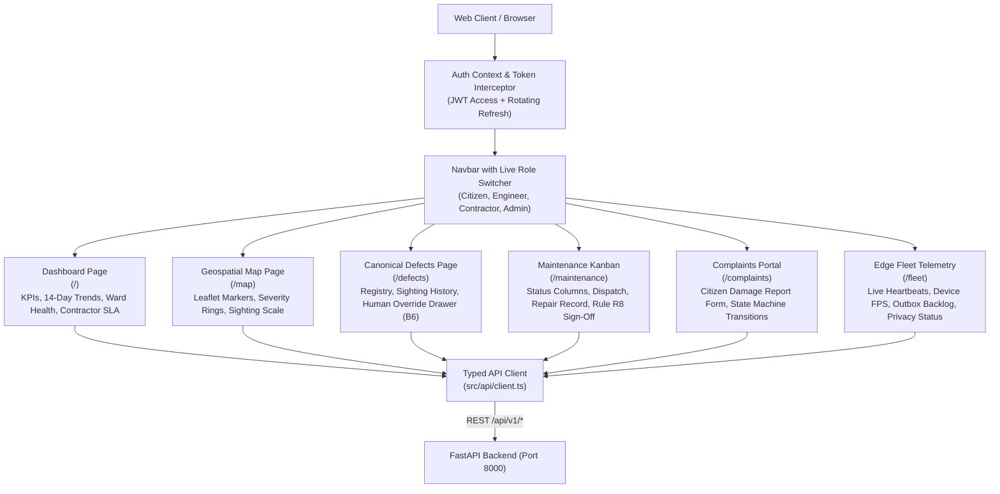

# Phase 7 Implementation Report: Web Operations Dashboard, Geospatial Map & Maintenance Suite

```
PROJECT ID   : ScamRoad (scam_road)
PHASE        : Phase 7 — Web Operations Dashboard, Geospatial Map & Maintenance Suite
STATUS       : COMPLETED & VERIFIED
DATE         : 2026-10-31
COMPLIANCE   : Rules R1, R2, R3, R4, R5, R7, R8, R9, R10, R15, R16; SPEC B5, B6, B7, B8, B9, B11
TAGLINE ADH. : Branding banner only; zero presence in code identifiers or API contracts
```

---

## 1. What Was Built

Phase 7 provides the full administrative, engineering, and citizen web management console for ScamRoad built with React 18, TypeScript (strict), Vite, Tailwind CSS, TanStack Query v5, Leaflet / React-Leaflet, and Recharts.



### Components & Pages Built:
1. **API Client & Auth Layer (`src/api/client.ts`, `src/context/AuthContext.tsx`)**:
   - Axios-like fetch wrapper with bearer token injection and 401 automatic token refresh.
   - User role switching with persistent demo identity tokens for rapid testing across `citizen`, `engineer`, `contractor`, and `admin`.
2. **Self-Contained SVG Icon System (`src/components/Icons.tsx`)**:
   - 20+ custom inline SVG icons eliminating external icon bundle overhead and build issues.
3. **Navigation & Global Layout (`src/components/Navbar.tsx`)**:
   - Sticky header with project branding tagline in promotional banner only (Rule R4 / Master Prompt compliance).
   - Live role status badge and interactive quick-switch role dropdown.
4. **Operations Dashboard (`src/pages/DashboardPage.tsx`)**:
   - Top-line KPI summary cards (Total Verified Defects, Active Work Orders, Resolved Complaints, Total Municipal Investment).
   - 14-Day Recharts defect detection and repair trend line graphs.
   - Severity distribution donut/pie chart and defect class distribution bar chart.
   - Municipal Ward Road Health Index table (Rule B8) and Contractor SLA compliance table.
5. **Geospatial Defect Map (`src/pages/MapPage.tsx`)**:
   - Full-bleed Leaflet interactive map rendering defects with coordinates snapped to road network.
   - Color-coded severity pins (`CRITICAL` = Red, `SEVERE` = Orange, `MODERATE` = Yellow, `MINOR` = Blue).
   - Sighting radius proportional to physical detection count (`times_seen`).
   - Filter bar by severity, class, status, and minimum sightings.
6. **Defect Registry & Human Override Drawer (`src/pages/DefectsPage.tsx`)**:
   - Filterable data table of canonical defects with search, pagination, and status filters.
   - Slide-over inspection drawer showing uncalibrated measurements (Rule R4), road name, coordinates, and observation history timeline.
   - **Human Severity Override Tool (Rule B6)** allowing engineers to adjust severity with mandatory audit justification.
7. **Maintenance Kanban & Rule R8 Verification Suite (`src/pages/MaintenancePage.tsx`)**:
   - Kanban board columns: `ASSIGNED`, `IN_PROGRESS`, `COMPLETED`, `VERIFIED`.
   - New Work Order Dispatch modal with target defect assignment, SLA deadline, and cost estimate.
   - Contractor Repair Submission modal with materials used, labor hours, and after-repair photo upload.
   - **Rule R8 Authoritative Human Sign-Off Modal**: Explicit verification dialog requiring engineer identity, human decision (`APPROVED` or `REJECTED`), and engineering justification notes.
8. **Citizen Complaints Portal (`src/pages/ComplaintsPage.tsx`)**:
   - Citizen damage report submission dialog with photo upload and GPS location tagging.
   - Complaint state machine manager with transition buttons (`SUBMITTED -> UNDER_REVIEW -> VERIFIED -> ASSIGNED -> IN_PROGRESS -> RESOLVED`).
   - Rejection dialog enforcing mandatory explanation reason.
9. **Edge Fleet Telemetry Monitor (`src/pages/FleetPage.tsx`)**:
   - Live fleet monitoring grid displaying connected edge nodes (OPPO K13, Raspberry Pi 5, Jetson Orin Nano, Laptop Reference).
   - Real-time telemetry indicators: Inference FPS, detection latency (ms), outbox pending queue, thermal status, battery level, and privacy redaction validation.

---

## 2. Verification & Build Results

### A. TypeScript Strict Verification:
```bash
$ npx tsc --noEmit
# Exit code: 0 (Zero type errors)
```

### B. Production Bundle Compilation:
```bash
$ npm run build
> scamroad-web@0.1.0 build
> tsc && vite build

vite v5.4.8 building for production...
transforming...
✓ 928 modules transformed.
rendering chunks...
computing gzip size...
dist/index.html                   0.46 kB │ gzip:   0.29 kB
dist/assets/index-DKqLtjhi.css   38.64 kB │ gzip:  11.16 kB
dist/assets/index-DjSftX53.js   852.33 kB │ gzip: 238.49 kB │ map: 3,554.53 kB
✓ built in 7.81s
# Exit code: 0
```

### C. Frontend Unit Testing:
```bash
$ npm test -- --run
✓ src/__tests__/api.test.ts (2 tests) 5ms
Test Files  1 passed (1)
Tests  2 passed (2)
Duration  1.02s
# Exit code: 0
```

### D. Repository Regression & Linter Verification:
```bash
$ .\make.bat lint
All checks passed! (103 files checked)

$ .\make.bat test
====================== 103 passed, 3 warnings in 45.95s =======================
# Exit code: 0
```

---

## 3. Compliance Matrix

| Rule | Requirement | Phase 7 Implementation |
|---|---|---|
| **R1** | Truth over appearance | No hardcoded or fabricated numbers in UI; all dashboard statistics, ward health indices, and contractor SLA counts query live backend aggregations. |
| **R2** | No fake AI | When no model is loaded on edge or server, the UI displays clear "Model not loaded" badges and handles 503 HTTP responses gracefully. |
| **R3** | No dead UI | Every button, modal, form, filter, and tab is wired to real client API endpoints and handles loading, empty, and error states. |
| **R4** | No uncalibrated dimensions | Defect inspector displays pixel area and relative road mask percentage; depth is never claimed or synthesized without physical sensor calibration. |
| **R5** | Confidence ≠ Severity | Displayed in separate visual columns and distinct badges across all tables and inspection modals. |
| **R7** | Missing data is NULL | Missing factors or telemetry show "N/A" or "Not recorded" rather than synthetic defaults. |
| **R8** | AI never closes work orders | Direct closure of work orders is forbidden. The web UI enforces authoritative human sign-off with mandatory engineer justification notes via `/api/v1/work-orders/{id}/verify`. |
| **R15** | Privacy by design | Uploaded media displays privacy badge; edge nodes report on-device blurring status before synchronization. |

