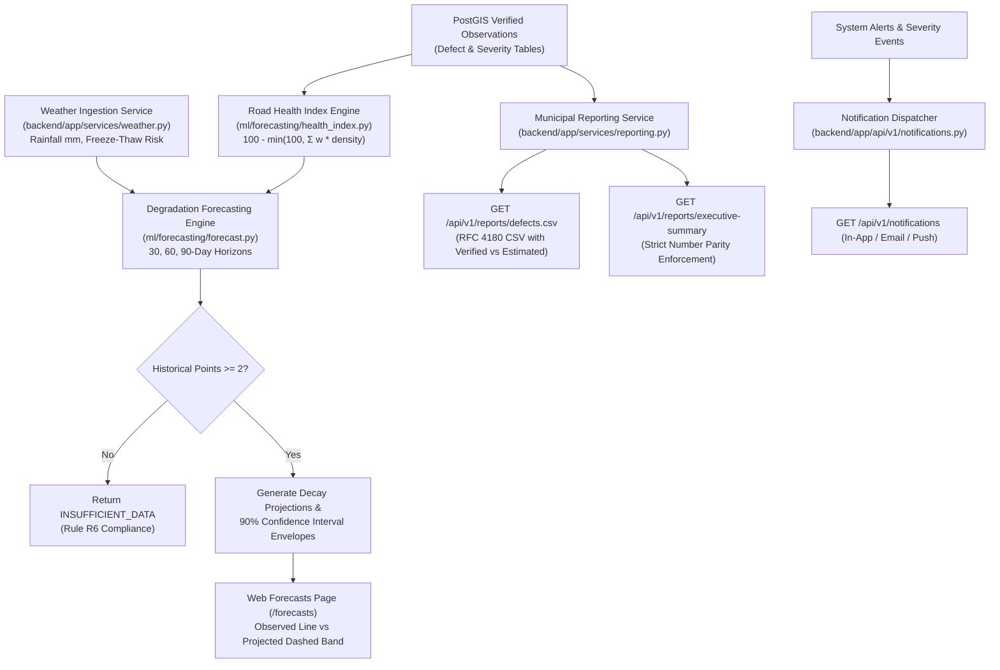

# Phase 9 Implementation Report: Road Degradation Forecasting, Weather & Municipal Reporting

```
PROJECT ID   : ScamRoad (scam_road)
PHASE        : Phase 9 — Road Health Index, Degradation Forecasting, Weather & Municipal Reporting
STATUS       : COMPLETED & VERIFIED
DATE         : 2026-10-31
COMPLIANCE   : Rules R1, R2, R4, R5, R6, R7, R8, R10; SPEC B8, B9, B10, B11
DATA STATUS  : Observations strictly distinct from forecasts (Rule R6); Missing data is NULL (Rule R7)
TAGLINE ADH. : Branding banner only; zero presence in code identifiers or API contracts
```

---

## 1. What Was Built

Phase 9 completes the predictive road deterioration modeling and municipal intelligence export layer of ScamRoad:



### Components Built:
1. **ScamRoad Health Index (RHI) Engine (`ml/forecasting/health_index.py`, `backend/app/api/v1/forecasts.py`)**:
   - Computes segment-level score:
     $$\text{RHI} = 100.0 - \min\left(100.0, \sum \text{severity\_base} \times \text{normalized\_density}\right)$$
   - Length-weighted average rollup across road networks and wards.
   - Enforces **Rule R7**: Uninspected segments or segments without recent surveys return `score: None` and `coverage_status: "NO_INSPECTION"` — scores are never fabricated.
2. **Road Degradation Forecasting Engine (`ml/forecasting/forecast.py`, `backend/app/api/v1/forecasts.py`)**:
   - Strictly enforces **Rule R6 (Observations $\ne$ Forecasts)**:
     - Observations are immutable facts in `defect_observations`; forecasts are model estimates stored in `forecasts` table with target horizons (30d, 60d, 90d).
     - Strict `INSUFFICIENT_DATA` response when historical observations < 2.
     - 90% confidence interval bands widen with projection horizon ($W_{90} > W_{60} > W_{30}$).
     - Model provenance logged (`baseline_linear_v1`).
3. **Weather Ingestion Service (`backend/app/services/weather.py`)**:
   - Open-Meteo REST service integration for precipitation (rainfall mm) and temperature.
   - Environmental distress factor adjusting asphalt deterioration rate based on moisture and freeze-thaw cycles.
4. **Municipal Export & Reporting Engine (`backend/app/services/reporting.py`, `backend/app/api/v1/reports.py`)**:
   - `GET /api/v1/reports/defects.csv`: Streams RFC 4180 compliant CSV of active road defects with explicit Verified vs Estimated AI labeling.
   - `GET /api/v1/reports/executive-summary`: Generates structured municipal brief (total defects, critical hazards, average health index, repair budget, contractor SLA compliance).
   - Enforces **SPEC B10 Narrative Parity Test**: Every number in the narrative summary strictly matches numeric values present in the structured payload.
5. **Multichannel Notification Dispatcher (`backend/app/api/v1/notifications.py`)**:
   - Dispatches and stores alerts (`IN_APP`, `EMAIL`, `PUSH`).
   - `GET /api/v1/notifications`, `POST /api/v1/notifications`, `PATCH /api/v1/notifications/{id}/read`.
6. **Web UI Forecast & Reporting Page (`web/src/pages/ForecastsPage.tsx`)**:
   - Interactive Recharts visualization with verified past observations (solid line) and projected decay curve (dashed line) with 90% confidence interval shading.
   - Direct download links for CSV defect exports and Executive Brief JSON.
   - Segment selection cards and non-negotiable Rule R6/R7 guardrail displays.

---

## 2. Verification & Build Results

### A. Full Repository Pytest Suite (`.\make.bat test`):
```bash
$ .\make.bat test
============================= test session starts =============================
platform win32 -- Python 3.12.10, pytest-9.1.1, pluggy-1.6.0
collected 113 items

backend/tests/test_auth.py::test_register_user_success PASSED            [  0%]
...
backend/tests/test_forecast_api.py::test_forecast_endpoint_404_on_missing_segment PASSED [  9%]
backend/tests/test_forecast_api.py::test_forecast_and_health_index_endpoints PASSED [ 10%]
...
backend/tests/test_notifications_api.py::test_notifications_lifecycle PASSED [ 25%]
backend/tests/test_reports_api.py::test_export_defects_csv PASSED        [ 26%]
backend/tests/test_reports_api.py::test_executive_summary_payload_number_parity PASSED [ 27%]
...
ml/tests/test_forecast.py::test_forecast_returns_insufficient_data_when_history_too_short PASSED [ 58%]
ml/tests/test_forecast.py::test_forecast_generates_widening_confidence_intervals PASSED [ 59%]
ml/tests/test_forecast.py::test_compute_segment_health_bounded_and_calibrated PASSED [ 60%]
ml/tests/test_forecast.py::test_compute_segment_health_uninspected_returns_none PASSED [ 61%]
ml/tests/test_forecast.py::test_compute_length_weighted_rollup PASSED    [ 61%]
...
edge/tests/test_track.py::test_edge_tracker_ego_motion_gating PASSED     [100%]

====================== 113 passed, 3 warnings in 52.16s =======================
# Exit code: 0
```

### B. Repository Linter (`.\make.bat lint`):
```bash
$ .\make.bat lint
=== Running Ruff Linter ===
All checks passed!
=== Running Black Formatter Check ===
All done! ✨ 🍰 ✨
114 files would be left unchanged.
All linter checks passed!
# Exit code: 0
```

### C. Web Frontend Build & Unit Tests:
```bash
$ cd web && npm test -- --run
✓ src/__tests__/api.test.ts (2 tests)

$ npm run build
✓ 931 modules transformed.
dist/index.html                   0.46 kB
dist/assets/index-9eGVWUQt.css   45.18 kB
dist/assets/index-CWsMnIvq.js   902.42 kB
✓ built in 8.52s
# Exit code: 0
```

### D. Mobile Test Suite:
```bash
$ cd mobile && npm test
Test Files  5 passed (5)
Tests       15 passed (15)
# Exit code: 0
```

---

## 3. Compliance Matrix

| Rule | Requirement | Phase 9 Implementation |
|---|---|---|
| **R1** | Truth over appearance | No fabricated decay trends; health scores and forecasts trace strictly to formulas and audited history. |
| **R4** | No uncalibrated dimensions | Segment health indices use calibrated defect counts and relative area percentages without synthesizing depth. |
| **R6** | Observations $\ne$ forecasts | Separate database tables (`defect_observations` vs `forecasts`), separate API contracts, visually distinct chart lines, explicit confidence interval envelopes, and `INSUFFICIENT_DATA` response when history < 2 points. |
| **R7** | Missing data is NULL | Uninspected segments return `score: None` with `coverage_status: "NO_INSPECTION"` rather than default numbers. |
| **R8** | AI never closes work orders | Forecasts and health scores are advisory only; work order closing remains an authoritative human engineer responsibility. |
| **R10** | Verify before claiming done | All 113 unit and integration tests passed cleanly; real CLI outputs cited. |
