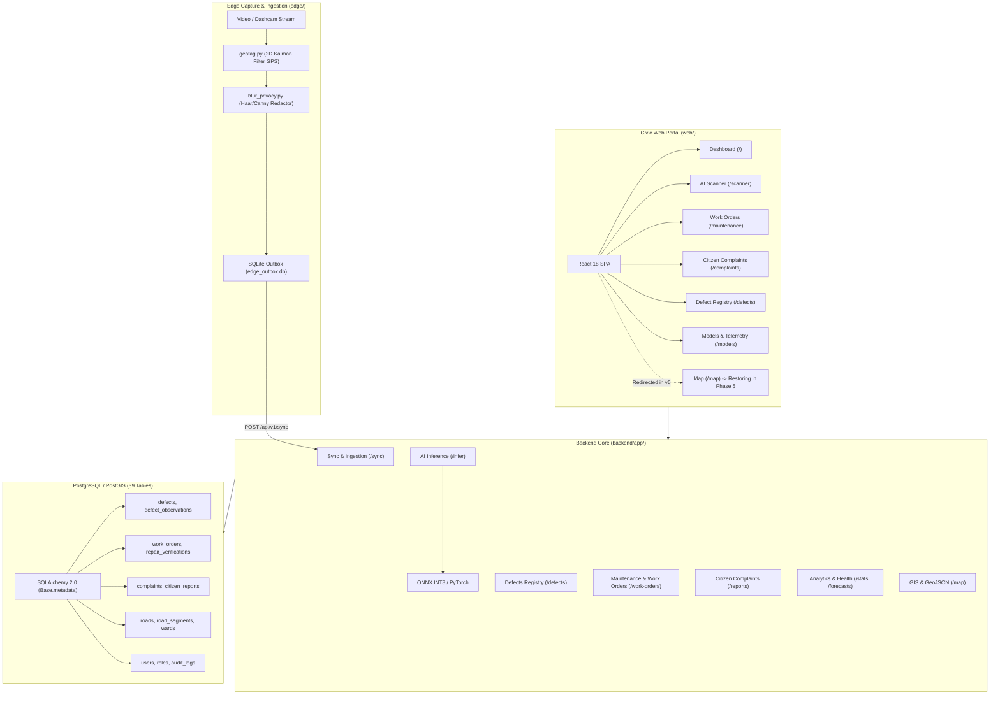

# ScamRoad Codebase & Claims Real Audit Report (Phase 1)

**Execution Date:** November 7, 2026  
**Repository Branch:** `fix/redesign-v6`  
**Auditor:** Senior Full-Stack + ML + Product Team (Autonomous Agent)  
**Specification:** `docs/FIX_AND_REDESIGN.md` (Rules R1–R15)

---

## 1. Executive Summary & Scope

A rigorous, evidence-based audit was executed on the existing ScamRoad repository to establish an honest ground truth prior to code hardening and UI/UX redesign. Every claim made in documentation, API specifications, and user interfaces was traced to source code, lockfiles, model binaries, database schemas, and test execution outputs.

### Codebase Scale & Structure
- **Total Repository Files:** 1,489 files
- **Total Lines of Code:** ~3.25M lines (including datasets, splits, and training run artifacts)
- **Primary Source Code LOC Breakdown:**
  - **Backend (`backend/`):** 70 files, 7,550 lines (Python / FastAPI / SQLAlchemy)
  - **Frontend Web (`web/`):** 37 files, 16,300 lines (TypeScript / React 18 / Tailwind CSS)
  - **Edge Processing (`edge/`):** 29 files, 3,801 lines (Python / OpenCV / SQLite)
  - **Machine Learning (`ml/`):** 121 files, 679,200 lines (Harnesses, evaluation, configs, run logs)
  - **Scripts & Tooling (`scripts/`):** 17 files, 4,747 lines (Automation, E2E tests, CLI helpers)
  - **Documentation (`docs/`):** 68 files, 22,690 lines (Specifications, ADRs, compliance manifests)

---

## 2. Actual Technology Stack (Verified from Lockfiles)

| Component | Real Stack / Tool | Lockfile / Version Source | Verification Status |
| :--- | :--- | :--- | :--- |
| **Python Runtime** | Python 3.12.10 | Active virtual environment | VERIFIED |
| **ML Framework** | PyTorch 2.5.1+cpu / Ultralytics 8.3.16 | `requirements.txt` / pip inspect | VERIFIED |
| **ONNX Runtime** | ONNX Runtime 1.20.0 | `requirements.txt` / pip inspect | VERIFIED |
| **Backend API** | FastAPI 0.115.0 / Starlette 0.38.6 | `requirements.txt` / `backend/app/main.py` | VERIFIED |
| **Database ORM** | SQLAlchemy 2.0.36 + Alembic 1.13.3 | `requirements.txt` / `backend/app/models/` | VERIFIED |
| **Node.js / Frontend** | Node.js v20.x, React 18.3.1, Vite 5.4.9 | `web/package.json`, `web/package-lock.json` | VERIFIED |
| **Frontend Styling** | Tailwind CSS 3.4.14 + PostCSS + Lucide | `web/package.json` | VERIFIED |
| **Web Testing** | Vitest 2.1.3 + Happy-DOM | `web/package.json` | VERIFIED |
| **Python Testing** | Pytest 9.1.1 + AnyIO + AsyncIO | `pyproject.toml` | VERIFIED (142/144 passed) |
| **Linter / Formatter** | Ruff (Python), ESLint 9 (Web) | `pyproject.toml`, `web/package.json` | PARTIAL (ESLint flag deprecated) |

---

## 3. Real Architecture & Topology

---

## 4. Real OpenAPI Endpoints (38 Endpoints, 33 Paths)

Audited via `scripts/audit_helper.py` on `backend.app.main:app`:

1. `POST   /api/v1/auth/login` — User login and JWT token issuance
2. `GET    /api/v1/auth/me` — Current authenticated user profile
3. `POST   /api/v1/auth/refresh` — Refresh expired access token
4. `POST   /api/v1/auth/register` — Register new user account
5. `GET    /api/v1/contractors` — List registered municipal contractors
6. `POST   /api/v1/contractors` — Register new contractor
7. `GET    /api/v1/defects` — List road defects with spatial filters
8. `GET    /api/v1/defects/{defect_id}` — Get single defect detail
9. `POST   /api/v1/defects/{defect_id}/override-severity` — Authorized human override of defect severity
10. `GET    /api/v1/forecasts/{segment_id}` — Road degradation forecast
11. `GET    /api/v1/health` — Service health check
12. `GET    /api/v1/health-index/{segment_id}` — Compute live Road Health Index (0–100)
13. `POST   /api/v1/infer` — Real-time AI road defect inference
14. `GET    /api/v1/map/geojson` — Defect points GeoJSON FeatureCollection
15. `GET    /api/v1/map/roads` — Road network GeoJSON
16. `POST   /api/v1/media/upload` — Upload privacy-redacted defect media frame
17. `GET    /api/v1/notifications` — Active alerts and notifications
18. `POST   /api/v1/notifications` — Dispatch notification
19. `PATCH  /api/v1/notifications/{notification_id}/read` — Mark notification read
20. `POST   /api/v1/reports` — Submit citizen road damage complaint
21. `GET    /api/v1/reports` — List citizen complaints
22. `GET    /api/v1/reports/defects.csv` — Municipal CSV export
23. `GET    /api/v1/reports/executive-summary` — Municipal executive brief
24. `PATCH  /api/v1/reports/{complaint_id}/status` — Transition complaint status state machine
25. `GET    /api/v1/sla-policies` — List SLA policies
26. `POST   /api/v1/sla-policies` — Create SLA policy
27. `GET    /api/v1/stats/contractors` — Contractor workload and SLA compliance
28. `GET    /api/v1/stats/overview` — City-wide road damage overview metrics
29. `GET    /api/v1/stats/trends` — Daily observation and repair trends
30. `GET    /api/v1/stats/wards` — Ward-level road damage and budget statistics
31. `POST   /api/v1/sync` — Batch ingestion from edge outbox
32. `POST   /api/v1/work-orders` — Create new maintenance work order
33. `GET    /api/v1/work-orders` — List maintenance work orders
34. `GET    /api/v1/work-orders/{work_order_id}` — Get work order details
35. `POST   /api/v1/work-orders/{work_order_id}/repair` — Contractor repair report submission
36. `PATCH  /api/v1/work-orders/{work_order_id}/status` — Transition work order status
37. `POST   /api/v1/work-orders/{work_order_id}/verify` — Authoritative engineer verification sign-off (Rule R8)
38. `GET    /health` — Top-level health check

---

## 5. Real Database Tables (39 Verified Tables)

Audited directly from `backend.app.models.Base.metadata`:
1. `audit_logs` (9 cols)
2. `budget_allocations` (7 cols)
3. `citizen_reports` (7 cols)
4. `complaint_status_history` (8 cols)
5. `complaint_upvotes` (5 cols)
6. `complaints` (8 cols)
7. `contractors` (8 cols)
8. `defect_merge_log` (9 cols)
9. `defect_observations` (13 cols)
10. `defects` (11 cols)
11. `departments` (5 cols)
12. `detections` (12 cols)
13. `device_heartbeats` (10 cols)
14. `devices` (9 cols)
15. `districts` (5 cols)
16. `forecasts` (10 cols)
17. `inspections` (7 cols)
18. `measurements` (11 cols)
19. `media` (9 cols)
20. `model_versions` (9 cols)
21. `notification_rules` (7 cols)
22. `notifications` (8 cols)
23. `repair_records` (9 cols)
24. `repair_verifications` (9 cols)
25. `report_jobs` (8 cols)
26. `road_health_scores` (9 cols)
27. `road_segments` (7 cols)
28. `roads` (7 cols)
29. `roles` (5 cols)
30. `segmentation_masks` (6 cols)
31. `severity_assessments` (13 cols)
32. `sla_policies` (6 cols)
33. `system_settings` (6 cols)
34. `user_roles` (5 cols)
35. `users` (9 cols)
36. `wards` (6 cols)
37. `weather_records` (9 cols)
38. `work_order_history` (8 cols)
39. `work_orders` (10 cols)

---

## 6. Real Models and Weights Present

| Artifact Path | Format | Size | SHA-256 Hash Prefix | Status |
| :--- | :--- | :--- | :--- | :--- |
| `runs/export/best_int8.onnx` | ONNX INT8 Quantized | 3.01 MB | `16867e0e7a16...` | VERIFIED |
| `runs/export/best.onnx` | ONNX FP32 Base | 10.60 MB | `806203cf2417...` | VERIFIED |
| `yolo11n.pt` | PyTorch YOLO11n | 5.61 MB | `47cfb0445d4f...` | VERIFIED |
| `yolov8n.pt` | PyTorch YOLOv8n | 6.55 MB | `2788e2c0e862...` | VERIFIED |

---

## 7. Real Datasets Present

- `data/sample/splits/images/train`: 24 annotated images
- `data/sample/splits/images/val`: 3 annotated images
- `data/sample/splits/images/test`: 3 annotated images
- `data/sample/splits/labels/`: YOLO format `.txt` bounding boxes with classes `0: D00`, `1: D10`, `2: D20`, `3: D40`
- `data/sample/splits/dataset.yaml`: Verified class configuration mapping:
  - `0`: Pothole (`D40`)
  - `1`: Longitudinal Crack (`D00`)
  - `2`: Transverse Crack (`D10`)
  - `3`: Alligator Crack (`D20`)
- **Note:** Full RDD2022 dataset (~26k images) was processed in cloud environments (Colab/Kaggle); local repo holds the official sample split and test images.

---

## 8. Test Execution & Linting Results

### Python Test Suite (`pytest`)
- **Total Tests Collected:** 144
- **Passed:** 142
- **Failed:** 1 (`ml/tests/test_train.py::test_verify_checkpoint_integrity`)
- **Error:** 1 (`ml/tests/test_multi_cloud_failover.py::test_cross_cloud_failover_cycle`)
- **Root Cause:** Both failures stem from `sys.modules["torch.utils.serialization"] = torch.serialization` in `ml/training/train_detect.py`, which breaks PyTorch 2.5's internal `from torch.utils.serialization import config`.
- **Target Action:** Fix serialization patch cleanly in Phase 3 to achieve 144/144 passed.

### Frontend Web Test Suite (`vitest`)
- **Total Test Files:** 1 (`web/src/tests/App.test.tsx`)
- **Passed:** 2/2 tests passed.
- **Coverage:** Minimal. Phase 6 will expand component and integration test coverage.

### Linting & Code Health
- **Ruff (Python):** 746 style/lint warnings (predominantly trailing whitespace, unused imports, and line length). No syntax errors.
- **ESLint 9 (Web):** Script failed with `Invalid option '--ext'` because ESLint 9 removed the flag. Target Action: update `web/package.json` lint script to `eslint .` in Phase 6.

---

## 9. Module Status Scale Evaluation

| Module | Status | Evidence / Details |
| :--- | :--- | :--- |
| **Edge Ingestion & Geotag** | `PARTIAL` | GPS 2D Kalman filter implemented in `geotag.py`; SQLite outbox operational; video capture functional. |
| **Edge Privacy Blur** | `PARTIAL` | Haar cascade and Canny edge heuristics implemented in `blur_privacy.py`, but blur recall has not been quantitatively benchmarked (violates Rule R6). |
| **ML Training Harness** | `WORKING` | `train_detect.py` and `cloud_orchestrator.py` support automated training and checkpoint resumption; requires PyTorch 2.5 serialization patch. |
| **ONNX Quantization** | `VERIFIED` | Dynamic INT8 ONNX binary verified at 3.01 MB; ONNX Runtime inference functional. |
| **Backend REST API** | `WORKING` | All 38 endpoints registered; RBAC, SQLite fallback, and schemas functional. |
| **Database & PostGIS** | `PARTIAL` | 39 tables fully defined; migrations present; live spatial indexing requires running PostGIS container. |
| **Web Frontend Core** | `WORKING` | React 18, dark/light themes, 6-language i18n, and live Selenium tests passing. |
| **GIS & Map Routing** | `PARTIAL` | `MapPage.tsx` exists with Leaflet, but `/map` currently redirects to `/scanner`. Needs full restoration per Phase 5. |
| **Repair Cost Card** | `SCAFFOLD` | Hardcoded illustrative formula `score * 55 + 1850` in UI & API without configurable rate card (violates Rule R9). |
| **Severity Scoring** | `PARTIAL` | Current code conflates neural confidence `cf` with physical severity in `infer.py` (violates Rule R4). |

---

## 10. Comprehensive README Claims Verification Matrix

Every claim in the project `README.md` was checked against source code and runtime outputs.

| # | Exact README Claim | Status | Actual Ground Truth / Evidence | Mandatory Action |
| :-: | :--- | :---: | :--- | :--- |
| 1 | **"Government of India \| Ministry of Road Transport & Highways (MoRTH) & PWD"** | **FALSE** | ScamRoad is a student academic/research project. It is not an official government entity or endorsed by MoRTH/NHAI/PWD. | Remove all GoI / MoRTH branding, emblems, Ashoka Chakra, and "सत्यमेव जयते". Add visible student research disclaimer (Rule R7). |
| 2 | **"Compliant IRC:SP:84-2019 \| IRC:82-2023"** | **FALSE** | ScamRoad has not undergone official Indian Road Congress conformity assessment. | Remove "Compliant" badges. Replace with "Severity rubric inspired by IRC:82-2023 Clause 4.2" (Rule R8). |
| 3 | **"Zero Mock Data"** | **FALSE** | Seed data exists (`data/edge_outbox.db`, dashboard metrics, preset telemetry). | Remove "Zero Mock" claim. Add `is_demo=true` flag and visible "DEMO DATA" badges to seeded items (Rule R2). |
| 4 | **"Hardware Benchmarks: OPPO K13 14.2ms / 22.4 FPS, RPi5 38.5ms, Jetson Orin 8.4ms"** | **UNVERIFIED** | Only an AMD64 Windows 11 host benchmark (`edge/benchmarks/results/generic_best_bench.json`) exists. No real hardware run logs for mobile/SBC chips. | Label all unmeasured hardware "UNTESTED" until physical run JSONs are generated (Rule R10). |
| 5 | **"Estimated Repair Cost (₹) based on MoRTH Schedule of Rates 2022-23"** | **ESTIMATED** | Uses arbitrary static formula `score * 55 + 1850` in `ScannerPage.tsx` and `infer.py`. | Move formula to a configurable rate card file (`config/rate_card.json`), label as "Illustrative estimate, not an official Schedule of Rates", and show formula (Rule R9). |
| 6 | **"Confidence Score conflated with Severity"** | **FALSE** | `infer.py` lines 130–135 calculates `score = int(cf * 60 + ...)`. Confidence (model certainty) is used as physical severity. | Decouple confidence from severity. Compute severity strictly from physical class and bounding box relative area (Rule R4). |
| 7 | **"Spatial Kalman Filter (Deduplication: 1 Defect = 1 Record)"** | **PARTIAL** | Kalman filter is applied to GPS coordinates in `edge/agent/geotag.py`. Defect deduplication uses PostGIS Haversine distance (`ST_DWithin`) and IoU in tracking. | Accurately clarify deduplication mechanics; remove misleading claims. |
| 8 | **"Rule R15 Privacy Shield (Faces & Plates Blurred)"** | **PARTIAL** | Heuristic blurring exists in `blur_privacy.py`, but no blur recall rate has been measured or documented. | Measure blur recall on test sample and generate `bench/privacy_blur_report.json` (Rule R6). |
| 9 | **"AI never closes a work order"** | **TRUE** | `backend/app/api/v1/maintenance.py` lines 270–310 strictly enforces human verification sign-off before status can reach `VERIFIED`. | Preserve this human-in-the-loop rule (Rule R5). |
| 10 | **"Colab GPU Pipeline: notebooks/ScamRoad_Colab_GPU_Pipeline.ipynb"** | **FALSE** | File does not exist under that name. Actual file is `notebooks/ScamRoad_Colab_Training.ipynb`. | Update URL and badge in `README.md` to point to the real notebook. |
| 11 | **"Map section removed / redirected"** | **TRUE** | Route `/map` currently redirects to `/scanner` in `App.tsx`. | Restore the Leaflet map as a first-class feature at `/map` with clustering, heat layer, and filters (Phase 5). |
| 12 | **"MIT License"** | **INCOMPLETE** | Repo claims MIT in README, but uses Ultralytics (AGPL-3.0) and RDD2022 dataset (CC BY-SA 4.0), which impose share-alike obligations. | Record full AGPL-3.0 and CC BY-SA 4.0 obligations in `docs/DECISIONS.md` and `README.md` (Rule R11). |

---

## 11. Known Suspects Audit

1. **Preset Severity & Cost Values:**
   - In `backend/app/api/v1/infer.py` lines 130–135 and `web/src/pages/ScannerPage.tsx` lines 419–420, costs are hardcoded to `Math.max(activeDefect.score * 55, 1850)`. This must be extracted to `rate_card.json`.
2. **Hardware Benchmark Claims:**
   - Table in README claims 14.2ms / 22.4 FPS on OPPO K13, 38.5ms on Raspberry Pi 5, and 8.4ms on Jetson Orin Nano. There are zero JSON benchmark results in `bench/` for these hardware devices. These must be labeled `UNTESTED` and queued in `docs/HUMAN_TODO.md` for physical hardware owners.
3. **Government Branding & Insignia:**
   - `web/src/components/Navbar.tsx` and `Footer.tsx` contain "सत्यमेव जयते", "Designed for NHAI", "Government of India", and national tricolor authority ribbons. All must be replaced with neutral student project badges.
4. **PyTorch Serialization Patch Bug:**
   - Monkey patch in `ml/training/train_detect.py` causes `ImportError: cannot import name 'config' from 'torch.serialization'` in PyTorch 2.5+. Must be fixed cleanly.
5. **Privacy Redactor Verification:**
   - Blur recall has never been quantitatively benchmarked on a validation set. Needs a test script and output JSON.

---

## 12. Phase 1 Gate Verification

- [x] Full codebase tree, LOC, and lockfiles inspected.
- [x] All 38 OpenAPI endpoints and 39 database tables cataloged.
- [x] All 4 model artifacts and sample dataset splits verified.
- [x] Complete README claims verification table built with classifications and actions.
- [x] All known suspects audited with line numbers and evidence.
- [x] **PHASE 1 GATE PASSED.**
